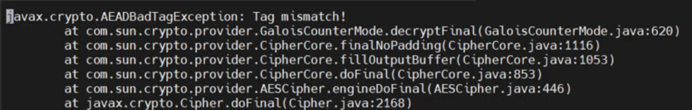

In this post we will encrypt and decrypt a given phrase using AES algorithm in GCM mode. This will be more on how to do it. I am not an expert on ciphers, but a basic way of how would you achieve the encryption/decryption will help in securing your applications. 

### **AES Algorithm**

> Advanced Encryption Standard(AES) is a symmetric, block cipher encryption/decryption algorithm.

By *symmetric *here, it means that the algorithm uses a secret key, which is used for encryption and decryption. So without the secret key entire encryption/decryption will fail. 

By *block cipher*, it means that the algorithm converts the plain text data into blocks which is then encrypted/decrypted. 

AES algorithm is based on [*substitution-permutation*](https://en.wikipedia.org/wiki/Substitution%E2%80%93permutation_network) principle, which takes the blocks of plain text and key as input and apply multiple **rounds **of *Substitution* and then *Permutation *on it, to produce the encrypted text. 

The key size specifies the number of **transformation **rounds that convert the plaint text to cipher text. The reverse rounds are applied to transform the cipher text to plain text (decryption). 

The number of rounds for each key size is as follows:


| **Rounds** | **Key Size** |
| --- | --- |
| 10 | 128 bits |
| 12 | 192 bits |
| 14 | 256 bits |


A *transformation *is a string that defines the set of operations performed to convert the plain text to cipher text. A transformation string will always include the *name of the algorithm* (like AES) and may be followed by a *feedback mode* and *padding scheme*. 

e.g. *AES/CBC/PKCS5Padding*

### **Feedback Modes**

Most commonly used modes is CBC with PKCS5Padding. And since CBC doesn't use the streams of cipher, GCM (Galois/Counter Mode) is preferred. 

These below information is from the Cipher class documentation in Java. 

Using modes such as CFB(Cipher Feedback) and OFB(Output feedback), block ciphers can encrypt data in units smaller than the cipher's actual block size. When requesting such a mode, you may optionally specify the number of bits to be processed at a time by appending this number to the mode name as shown in the "AES/CFB8/NoPadding" and "AES/OFB32/PKCS5Padding" transformations. If no such number is specified, a provider-specific default is used. Thus, block ciphers can be turned into byte-oriented stream ciphers by using an 8 bit mode such as CFB8 or OFB8.

Modes such as ***Authenticated Encryption with Associated Data (AEAD)*** provide authenticity assurances for both confidential data and Additional Associated Data (AAD) that is not encrypted. Both confidential and AAD data can be used when calculating the authentication tag (similar to a [Mac](https://docs.oracle.com/javase/8/docs/api/javax/crypto/Mac.html)). This tag is appended to the ciphertext during encryption, and is verified on decryption.

AEAD modes such as *GCM/CCM* perform all AAD authenticity calculations before starting the ciphertext authenticity calculations. To avoid implementations having to internally buffer ciphertext, all AAD data must be supplied to GCM/CCM implementations (via the *updateAAD* methods) **before** the ciphertext is processed (via the update and *doFinal* methods).

Note that GCM mode has a uniqueness requirement on IVs used in encryption with a given key. When IVs are repeated for GCM encryption, such usages are subject to forgery attacks. Thus, after each encryption operation using GCM mode, callers should re-initialize the cipher objects with GCM parameters which has a different IV value.

### **Implementation**

Let's look into the implementation of the AES algorithm with GCM mode. 

You can download the cipher zip supported by Java from [*JCE Unlimited Strength Policy*](https://www.oracle.com/java/technologies/javase-jce8-downloads.html)*.* 

### **Encryption**

The *Initialization vector(IV)* size we will use is 16 bytes, which is equivalent to 16 * 8 = 128 bits. We will use *SecureRandom *class to initialize random bytes to *Initialization Vector(IV).*

```java
byte IV[] = new byte[IV_SIZE];
SecureRandom secRandom = new SecureRandom() ;
secRandom.nextBytes(IV);
```

We have to get the cipher instance of the transformations we want, here we will use AES/GCM/NoPadding. This should be same for encryption and decryption.

```java
Cipher cipher = Cipher.getInstance("AES/GCM/NoPadding");
```

This cipher class will be used to add the authentication tag data. For authentication tag data, use a byte array. We have used this

```java
byte[] aadTagData = "dynamicallyblunttech".getBytes() ;
```

We will then need the *GCMParameterSpec *object which sets the necessary parameters required for GCM mode. 

In CBC mode, it only requires an Initialization Vector(IV) such as *IvParameterSpec, *but in GCM mode, it requires the IV and the tLen which is the length of authentication tag(in bits).

```java
public static final int GCM_TAG_LENGTH = 128;
GCMParameterSpec gcmParameterSpec = new GCMParameterSpec(
                             GCM_TAG_LENGTH, IV);
```

We have to create the SecretKey which will be used in encryption and decryption of our passwords. It will take String as an input and uses SHA-256 as Message Digest instance. 

> Message Digest is a secure one way hash function which takes arbitrary length data and generates fixed sized hash value. It uses Message Digest algorithm such as MD5 or SHA-1 or SHA-256

```java
key = secretKey.getBytes("UTF-8");
MessageDigest sha = MessageDigest.getInstance("SHA-256");
key = sha.digest(key);
key = Arrays.copyOf(key, 16);
sks = new SecretKeySpec(key, "AES");
return sks;
```

Now that we have all the things required to initialize my Cipher instance. And the Cipher.init() method takes the 
* mode (1-Encrypt, 2-Decrypt)
* Key (Secret Key)
* Parameter Set (GCMParameterSpec)
* SecureRandom (instance)

```java
cipher.init(Cipher.ENCRYPT_MODE, secretKey, gcmParameterSpec, secRandom);
```

Once the cipher is initialized with above values, we have to update the plain text as byte[] into the Cipher instance. But before updating the plain text, we need to update Authentication Tag using updateAAD() method of Cipher instance.

```java
cipher.updateAAD(aadTagData);
cipher.update(bytePassword);
```

After this, call the *doFinal()* method of Cipher instance, which will return a byte array of encrypted string. 

```java
byte[] encryptedBytes = cipher.doFinal();
```

Now majorly two important points here:
* In most of the working code, you will be dealing with character array and not Strings. Since String pose security risk as its an immutable object and cannot be changed, rather a change will create a new String. But if we use the character array, we can initialize the value to empty to some random value after the sensitive data is not required. So, how to convert the character array to byte array without missing any bytes ?
* Another point is, now we have the secret key, IV which will be required to decrypt the message. Where do we store them ? Storing it in disk space pose another security risk of the key to be damaged or lost or used by attackers to identify the message.

We can convert the character array to byte array by using ByteBuffer class.

```java
ByteBuffer byteBuffer = Charset.defaultCharset()
        .encode(CharBuffer.wrap(toEncrypt));
byte[] bytePassword = new byte[byteBuffer.remaining()];
byteBuffer.get(bytePassword);
```

And to store the encrypted message and IV so that we can use it during decryption, we can append the IV to the encrypted message and encode the string using Base64 again. 

```java
byte[] ivCTAndTag = new byte[IV.length + encryptedBytes.length];
System.arraycopy(IV, 0, ivCTAndTag, 0, IV.length);
System.arraycopy(encryptedBytes, 0, ivCTAndTag, IV.length, encryptedBytes.length);

Base64.getEncoder().encodeToString(ivCTAndTag);
```

Above code is to create a byte array of combined size of IV and the encrypted String. And then copy the IV and encrypted bytes to the new array. To even add more complexity, you can do some other operations (like introducing extra bytes in some order etc) here for more security.

Since the way we used to create the secret key will provide the same key, we can create a random text given as input. Thus, for every deployment of you application, it will generate a different input key for the *generateSecretKey()* method and thus different secret key. 

### **Decryption**

We will use the same algorithm transformations to create a new Cipher instance. Decode our message and then extract the IV bytes and encrypted message from the encrypted bytes.

We will follow the same way, where we create the *GCMParameterSpec *instance using the extracted *IV*, initialize the Cipher instance with *Decrypt *mode, the secret key, *GCMParameterSpec *instance and the *SecureRandom *instance.

Then will update the authentication tag for the Cipher instance and update the encrypted bytes. Finally, use the *doFinal()* to get the decrypted bytes, which can be converted to String.

```java
Cipher cipher = Cipher.getInstance("AES/GCM/NoPadding");
byte[] decodedToDecrypt = Base64.getDecoder().decode(toDecrypt);

byte[] IV = new byte[IV_SIZE];
System.arraycopy(decodedToDecrypt, 0, IV, 0, IV.length);

GCMParameterSpec gcmParameterSpec = new GCMParameterSpec(GCM_TAG_LENGTH, IV);
byte[] encryptedBytes = new byte[decodedToDecrypt.length - IV.length];
System.arraycopy(decodedToDecrypt, IV.length, encryptedBytes, 0, encryptedBytes.length);

cipher.init(Cipher.DECRYPT_MODE, secretKey, gcmParameterSpec, new SecureRandom());
cipher.updateAAD(aadTagData);
cipher.update(encryptedBytes);

byte[] decryptedBytes = cipher.doFinal();
```

If you have any comments or more information, kindly comment down in this post. You can refer to the entire code on my [*Github*](https://github.com/ankitagrahari/Tryouts/blob/master/src/main/java/com/dmtryouts/EncryptDecrypt/AESGCMDMCrypt.java). 

## **[UPDATE]**

While testing some of the passwords, I found that the above code would give an *AEADTagException *for the password's with length greater than the block size. 

This is because of the *Cipher.update(bytes[])* method. 

Referring to the documentation, you would find that

> **Returns:**the new buffer with the result, or null if the underlying cipher is a block cipher and ***the input data is too short to result in a new block.***

So, the fix would be to directly pass the bytes[] in *cipher.doFinal()* method of Cipher. And avoid the *cipher.update()* method.*** ***

```java
byte[] encryptedBytes = cipher.doFinal(bytePassword);
```

### References
* [*https://docs.oracle.com/javase/8/docs/api/javax/crypto/Cipher.html*](https://docs.oracle.com/javase/8/docs/api/javax/crypto/Cipher.html)* *
* [*https://docs.oracle.com/javase/8/docs/api/javax/crypto/spec/GCMParameterSpec.html*](https://docs.oracle.com/javase/8/docs/api/javax/crypto/spec/GCMParameterSpec.html)* *
* [*https://www.javacodegeeks.com/2017/12/choosing-java-cryptographic-algorithms-part-2-single-key-symmetric-encryption.html*](https://www.javacodegeeks.com/2017/12/choosing-java-cryptographic-algorithms-part-2-single-key-symmetric-encryption.html)* *
* [*https://en.wikipedia.org/wiki/Galois/Counter_Mode*](https://en.wikipedia.org/wiki/Galois/Counter_Mode)* *
* ***[UPDATE] ***[*Cipher.update(byte[]) Documentation Link*](https://docs.oracle.com/en/java/javase/17/docs/api/java.base/javax/crypto/Cipher.html#update(byte%5B%5D))

Hope you like the content of the blog. Please do suggest more content topics of your choice and share your feedback. Also [*subscribe and appreciate*](https://razorpay.com/payment-button/pl_IKvqCobZrv20Av/view/?utm_source=payment_button&utm_medium=button&utm_campaign=payment_button) the blog if you like it.