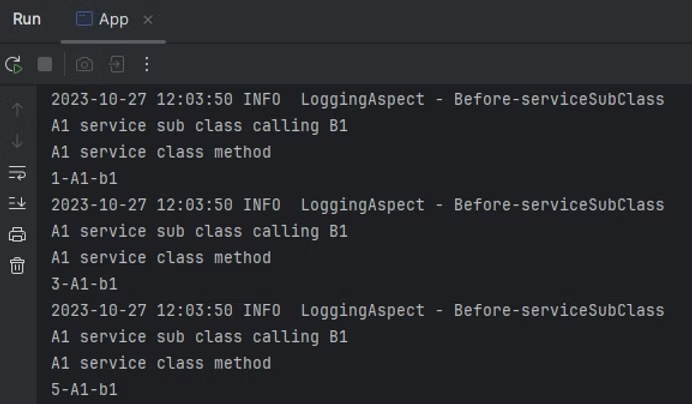
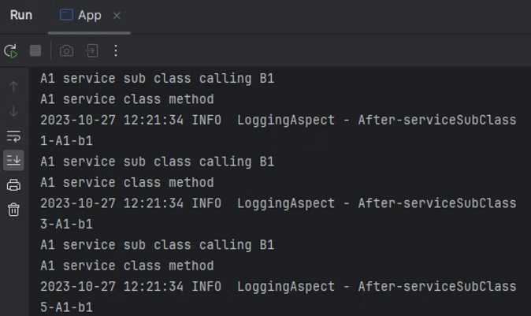
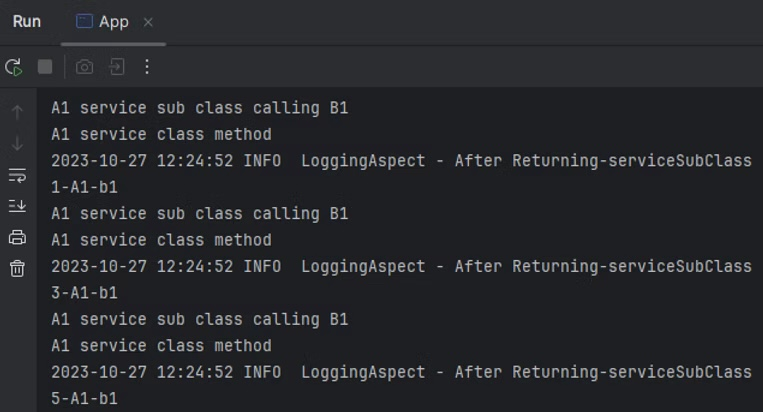
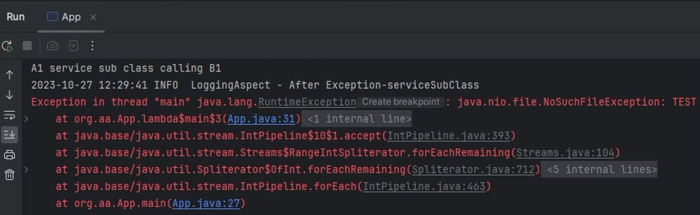
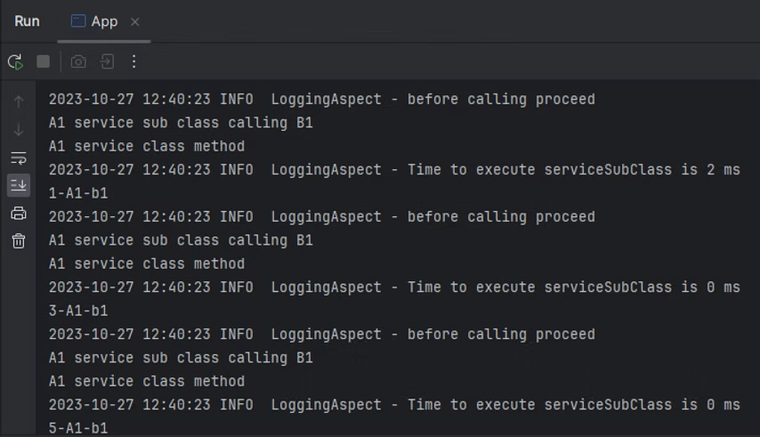

Spring provides a simple and powerful way of writing custom wrappers function which can be executed around a range of methods. Aspect-oriented programming complements Object-oriented programming by providing another way of thinking about program structure. 

> The key unit of modularity in Aspects oriented programming (AOP) is the  Aspects. Aspects enables modularization of concerns that cut across multiple types and objects. Such concerns are termed as "cross-cutting" concerns.

AOP is used in Spring framework to:
* Provide declarative enterprise services (e.g. declarative transaction management)
* Implements custom aspects.

The above details are directly taken from the Spring documentation. When we talk about the modularity, it means how each functional unit behaves. Aspects-oriented programming allow developers to do specific things around these functional unit in order to add more value to its behavior. Logging is a very common example, where I want to add logging to all the methods before or after or around its execution. Transaction management is also one such example. 

We will use Logging as an example in this post to explore more on this feature. Before that, let's look into few more terminology that is used in Aspect-oriented programming. 

Now, it is evident that we have three important items when we want to execute something around some functionality. 
* First is my code where I want to add the extra functionality (cross-cutting concerns). This is know as #JoinPoint.
* Second is the selection criteria to select the #Joinpoint to apply that cross-cutting concerns.
* Third is the reusable code which I want to implement when the #Joinpoint is recognized. This is known as #Advice.

Now lets look into the official definition of these terms:
* **Aspects**: A modularization of a concern that cut across multiple classes. In Spring AOP, aspects are implemented by using regular classes (the scheme-based approach) or regular classes annotated with the @Aspect annotation (the @AspectJ style.)
* **Join point**: A point during the execution of a program, such as execution of a method or handling of exception. In Spring AOP, a join point always represent method execution.
* **Advice**: Action taken by an aspect at a particular join point. Different types of advice include "*around*", "*before*" and "*after*" advice.
* **Pointcut**: A predicate that matches the join point.
* **Weaving**: linking aspects with other application types or objects to create and advised object. This can be done at compile time (using AspectJ compiler), load time, or at runtime. The weaving is done at byte-code level and called byte-code weaving as well.

##### ** AOP Proxies**
* Spring AOP default to use standard JDK dynamic proxies for AOP proxies. This enables all the interface can be proxied.
* Spring AOP can also use CGLIB proxies which makes the classes rather than interfaces.

Lets look into the basics implementation of creating any Aspects. 

First and Foremost is to enable AspectJ in you spring application. In this example we are taking the spring-core libraries only with AspectJ dependency. 

#### **Dependencies**

So, the pom will look like:

```java
<dependency>
  <groupId>org.springframework</groupId>
  <artifactId>spring-core</artifactId>
  <version>${spring.version}</version>
</dependency>

<dependency>
  <groupId>org.springframework</groupId>
  <artifactId>spring-context</artifactId>
  <version>${spring.version}</version>
</dependency>

<dependency>
  <groupId>org.aspectj</groupId>
  <artifactId>aspectjweaver</artifactId>
  <version>1.9.19</version>
</dependency>
```

Additionally, we will add the log4j libraries to enable logging for all methods. 

```java
<dependency>
  <groupId>org.slf4j</groupId>
  <artifactId>slf4j-log4j12</artifactId>
  <version>2.0.7</version>
</dependency>
```

These are all the dependencies required for our Spring core project.

#### **Configuration**

In order to enable AspectJ and load the configuration we will create a configuration class. 

```java
import org.springframework.context.annotation.ComponentScan;
import org.springframework.context.annotation.Configuration;
import org.springframework.context.annotation.EnableAspectJAutoProxy;
import org.springframework.context.annotation.PropertySource;

@PropertySource(value = "classpath:application.properties")
@ComponentScan(basePackages = "org.aa")
@Configuration
@EnableAspectJAutoProxy
public class AppConfig {}
```

The above code 
* sets the configuration files location
* sets the base packages to recognize the components.
* enable AspectJ proxy.

#### **Aspects**

To enable logging for all the method execution, we will be creating Logging interface which will be used over method as annotation where we want to enable logging. 

```java
import java.lang.annotation.ElementType;
import java.lang.annotation.Retention;
import java.lang.annotation.RetentionPolicy;
import java.lang.annotation.Target;

@Target(ElementType.METHOD)
@Retention(RetentionPolicy.RUNTIME)
public @interface Loggable {}
```

In the above code, we are creating custom annotation for logging purpose which sets 
* if @Target meta-annotation is present, then compiler will restrict the usage based on the *ElementType *enum, in this case it is methods.
* @Retention annotation indicates how long the annotation with the annotated method to be retained.

Now we will be creating the *LoggingAspect *using the Logging annotation which we created above. In this class we will create different types of Advices and also see the order of the execution. 

```java
@Component
@Aspect
public class LoggingAspect{

    private static final Logger LOG = LoggerFactory.getLogger(LoggingAspect.class);
    
    @Pointcut("@annotation(Loggable)")
    public void executeLogging(){}
    .
    .
    .
```

We have to annotate the *LoggingAspect* class with the @Aspect annotation to use this as the aspect class for our logging objective. 

In the above code, we have defined our Pointcut operation which are method annotated with the annotation *Loggable*, there by separating the concerns. 

#### **Services**

For this task, we have two services created, where one service calls another service.

###### **A1Service.java**

```java
@Service
public class A1Service {

    B1Service b1Service;

    public A1Service(B1Service b1Service){
        this.b1Service = b1Service;
    }

    @Loggable
    public String serviceClass(){
        System.out.println("A1 service class method");
        return "A1";
    }

    @Loggable
    public String serviceSubClass() {
        System.out.println("A1 service sub class calling B1");
        return serviceClass()+b1Service.serviceSubClass();
    }
}
```

###### **B1Service.java**

```java
@Service
public class B1Service {

    public String serviceClass(){
        return "B1";
    }

    public String serviceSubClass(){
        return "-b1";
    }
}
```

If you observe, we have @Loggable added on the *A1Service* methods while the *B1Service* is not bounded by the aspects. 

#### **Main**

In my main method, we are calling the *serviceSubClass*() method of *A1Service* odd number of times in the range 1 to 10.

```java
public class Main {
    public static void main( String[] args ) {
        ApplicationContext ac = new AnnotationConfigApplicationContext(AppConfig.class);
        B1Service b1 = ac.getBean(B1Service.class);
        A1Service a1 = ac.getBean(A1Service.class);
       
        IntStream
                .rangeClosed(1, 10)
                .filter(x -> x%2!=0)
                .forEach(x -> System.out.println(x+"-"+ a1.serviceSubClass()));
    }
}
```

We are using *AnnotationConfigApplicationContext *to get the service beans. 

Next, we will implement different Advices.

##### **@Before**

This advice will run before the execution of the method starts.

```java
.
.
@Before("executeLogging()")
public void logCall(JoinPoint jp){
    LOG.info("Before-"+jp.getSignature().getName());
}
.
.
```

In continuation with the above code sample, this method will be added with @Before advice annotation which tells the Pointcut expression where to bind the object. In this case it is *executeLogging*() method. 

So before executing the method, it will execute this advice. 

If you see the order, before executing the method, we have the *LoggingAspect* log in the run console. 

##### **@After**

Unlike @Before, this advice will be executed after the method execution is done. The important aspect to consider is that the advice will run irrespective of whether an exception occurred during the method execution.  

```java
@After("executeLogging()")
public void logAfterCall(JoinPoint jp){
    LOG.info("After-"+jp.getSignature().getName());
}
```

We can see from the logs that it is executed after the method execution


@After has two more variation to it, @AfterThrowing and @AfterReturning. As the name suggests, @AfterThrowing advice will get executed if the method is throwing any exception, and @AfterReturning advice will get executed if the method is returning something.

##### **@AfterRetuning**

```java
@AfterReturning("executeLogging()")
public void logAfterReturnCall(JoinPoint jp){
    LOG.info("After Returning-"+jp.getSignature().getName());
}
```

This will have following logs 


##### **@AfterThrowing**

We have to change the *serviceSubClass*() to throw *NoSuchFileException *for this to work. 

```java
@AfterThrowing("executeLogging()")
public void logAfterThrowingCall(JoinPoint jp){
    LOG.info("After Exception-"+jp.getSignature().getName());
}
```

This will have following logs


##### **@Around**

The @Around annotation will bring a new variant where the *ProceedingJoinPoint* exposes proceed() method to support @Around advice execution. 

Before the proceed() call, the advice is executed, and 

on the proceed() call, it will execute the method and return an Object

After the proceed() call, the remaining advice part is executed. 

You can see the advice implementation

```java
@Around(value = "executeLogging()")
public Object logMethodCall(ProceedingJoinPoint pjp) throws Throwable {
    long startTime = System.currentTimeMillis();
    LOG.info("before calling proceed");
    //method return value
    Object returnValue = pjp.proceed();
    long runTimeForMethod = System.currentTimeMillis() - startTime;
    LOG.info("Time to execute "+ pjp.getSignature().getName() + " is "+ runTimeForMethod +" ms");
    return returnValue;
}
```

and the logs will be evident to tell how the order of execution will be.


This all on the Spring AOP implementation. This time all the code is present in this post and will update this, once all my Github check-in's are done.

Do comment out and like if you like the post or wanted more details on its working, or if any modification is to be done. It will be helpful as a community to grow. 

### **References**
* [https://docs.spring.io/spring-framework/reference/core/aop/using-aspectj.html](https://docs.spring.io/spring-framework/reference/core/aop/using-aspectj.html)
* [https://www.linkedin.com/learning/spring-spring-mvc-2](https://www.linkedin.com/learning/spring-spring-mvc-2)