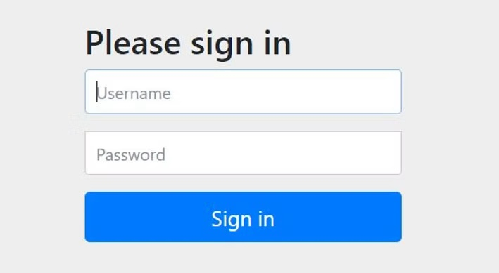

Referring to the [*Spring Guide*](https://spring.io/guides/gs/authenticating-ldap/) to Spring security for authenticating a user with LDAP, this blog is to create the working example for someone to try it out.

The example present as part of the guide is having some configuration missing, without which the example won't work. I got to know from some Stackoverflow pages about the missing configurations and added the correct form to this post.

## Dependencies

I am using Maven for my project and it requires following external libraries for enabling the LDAP authentication in our spring project.

```java
<dependency>
    <groupId>org.springframework.boot</groupId>
    <artifactId>spring-boot-starter-security</artifactId>
</dependency>
<dependency>
    <groupId>org.springframework.ldap</groupId>
    <artifactId>spring-ldap-core</artifactId>
</dependency>
<dependency>
    <groupId>org.springframework.security</groupId>
    <artifactId>spring-security-ldap</artifactId>
</dependency>
<dependency>
    <groupId>com.unboundid</groupId>
    <artifactId>unboundid-ldapsdk</artifactId>
</dependency>
```

## Web Security Configurer Adapter

In order to get the LDAP authentication working, we have to add another configuration which will extend *WebSecurityConfigurerAdapter *class. The *configure()**** ***method will be overridden to manually add some additional configuration for the login works in your spring project. The *WebSecurityConfigurerAdapter *class implements *WebSecurityConfigurer *interface. 

It also provides an embedded LDAP server with default configuration. We will use *ldapauthentication()* method which will configure things so that the username in the login form is plugged into *{0}* such that it searches below pattern in the LDAP server 

```java
uid={0},ou=people,dc=springframework,dc=org
```

In the flow, the configure method with *AuthenticationManagerBuilder *class as argument will be called first and after that it will call the other configure method with *HttpSecurity *method.

```java
@Override
public void configure(AuthenticationManagerBuilder auth) throws Exception {
        auth.ldapAuthentication()
                .userDnPatterns("uid={0},ou=people")
                .groupSearchBase("ou=groups")
                .contextSource()
                .url("ldap://localhost:8389/dc=springframework,dc=org")
                .and()
                .passwordCompare()
//                .passwordEncoder(new BCryptPasswordEncoder())
                .passwordAttribute("userPassword");
}
```

**NOTE:** In the above configure method, keep the *passwordEncoder *line commented, else the user authentication will not work. It was throwing user authentication failed when we enable the *BCryptPasswordEncoder *class.


After the above configure method the below configure method will be called

```java
@Override
protected void configure(HttpSecurity http) throws Exception {
        http.authorizeRequests()
                .anyRequest()
                .fullyAuthenticated()
                .and()
                .formLogin();
}
```

## LDAP Data Interchange Format file

The *ldif* file contains the user repository for the users which are allowed to access the application with respective users details, groups and other permissions.

Refer to the file here: [*test-server.ldif*](https://github.com/ankitagrahari/CowinCo/blob/main/src/main/resources/test-server.ldif)

## Configurations in application.properties

If you run the spring guide example as is, you will get an application error on the runtime that the root 389 connection refused error.

```java
2021-11-09 22:52:41.170  INFO 5760 --- [-192.168.225.52] o.s.web.servlet.DispatcherServlet        : Initializing Servlet 'dispatcherServlet'
2021-11-09 22:52:41.182  INFO 5760 --- [-192.168.225.52] o.s.web.servlet.DispatcherServlet        : Completed initialization in 12 ms
2021-11-09 22:52:41.865  WARN 5760 --- [-192.168.225.52] o.s.b.actuate.ldap.LdapHealthIndicator   : LDAP health check failed

org.springframework.ldap.CommunicationException: localhost:389; nested exception is javax.naming.CommunicationException: localhost:389 [Root exception is java.net.ConnectException: Connection refused: connect]
    at org.springframework.ldap.support.LdapUtils.convertLdapException(LdapUtils.java:108) ~[spring-ldap-core-2.3.3.RELEASE.jar:2.3.3.RELEASE]
    at org.springframework.ldap.core.support.AbstractContextSource.createContext(AbstractContextSource.java:355) ~[spring-ldap-core-2.3.3.RELEASE.jar:2.3.3.RELEASE]
    at org.springframework.ldap.core.support.AbstractContextSource.getReadOnlyContext(AbstractContextSource.java:164) ~[spring-ldap-core-2.3.3.RELEASE.jar:2.3.3.RELEASE]
```

In order to resolve these errors we need to add the following configurations:

```java
spring.ldap.embedded.port=8389
spring.ldap.embedded.ldif=classpath:test-server.ldif
spring.ldap.embedded.base-dn=dc=springframework,dc=org
```

The port for ldap server is mentioned with the *spring.ldap.emebedded.port* key and 

the ldif file location is in classpath is given with *spring.ldap.embedded.ldif* key and

the root DN is given by the last key *spring.ldap.embedded.base-dn*

Once the above configuration is added, then on application startup, the browser will show a login page with /login URL and it will only accept users given as part of the test-server.ldif file.



You can find the complete code base in [*Github here*](https://github.com/ankitagrahari/CowinCo/tree/main/src/main/java/ank/cowin/ldap)*.*

Please do suggest more content topics of your choice and share your feedback. Also [*subscribe and appreciate*](https://www.dynamicallyblunttech.com/#:~:text=3-,Subscribe%20Form,-Stay%20up%20to) the blog if you like it.