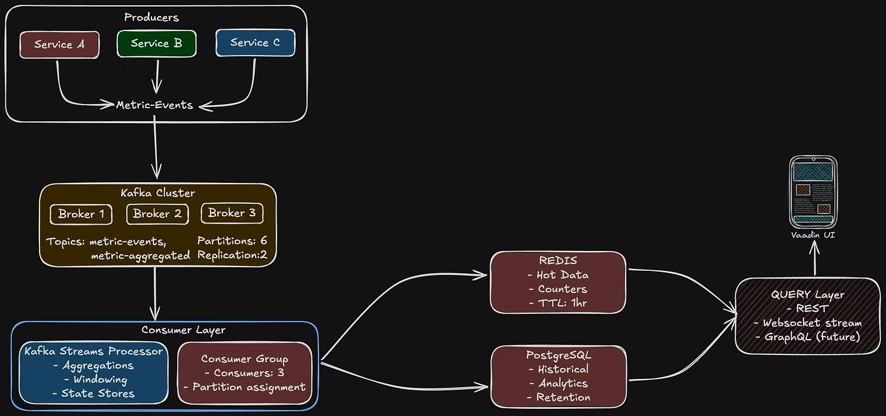
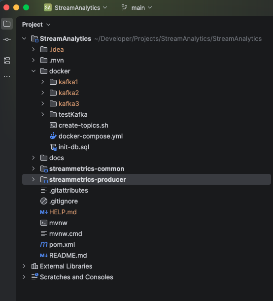
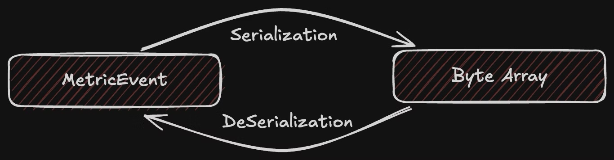
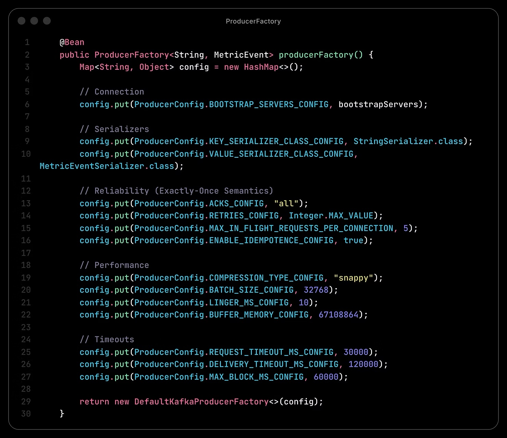
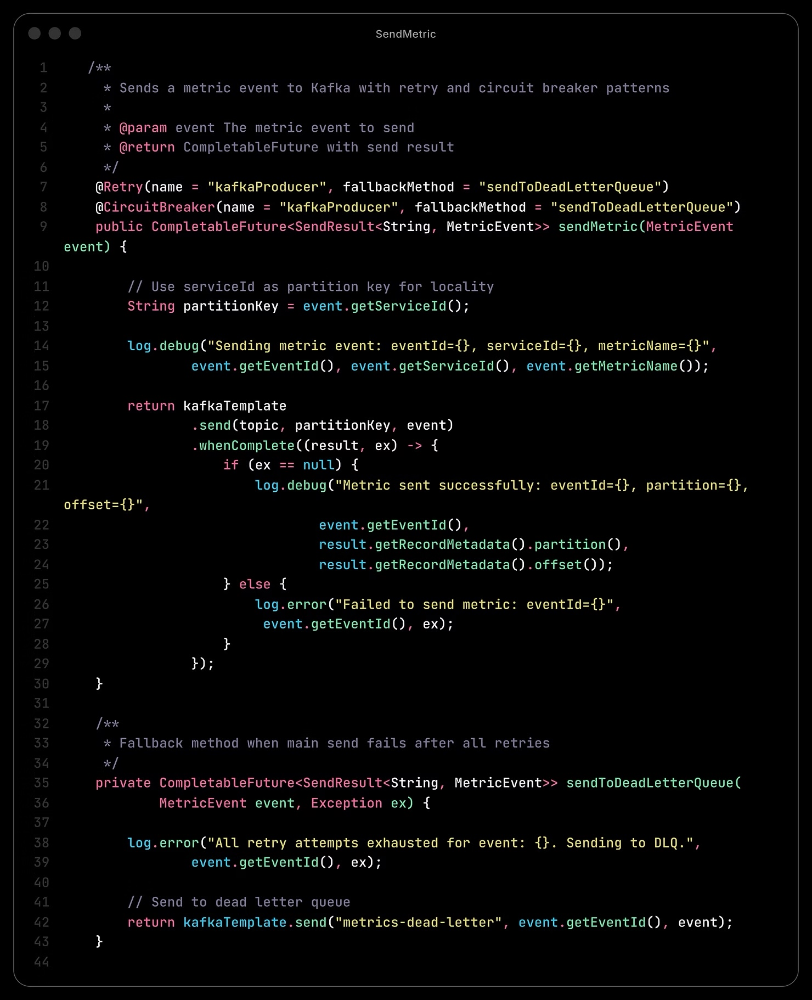
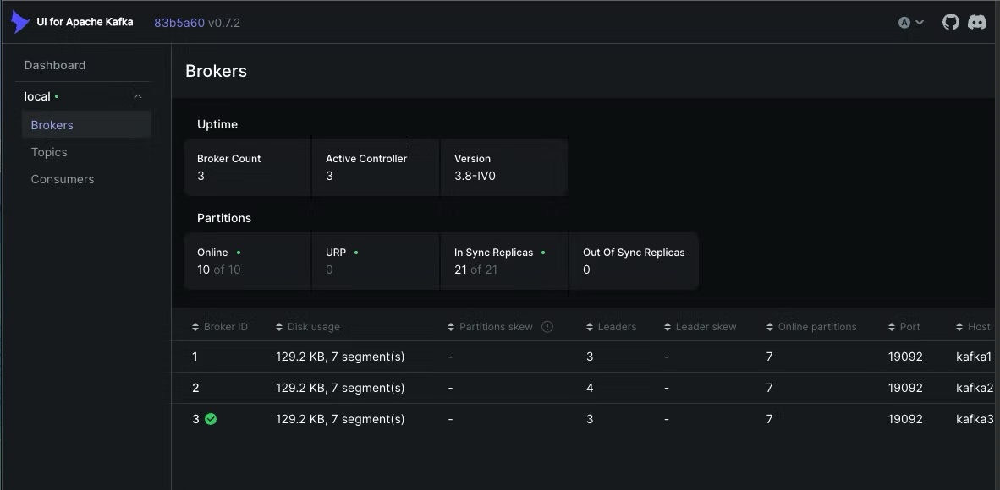
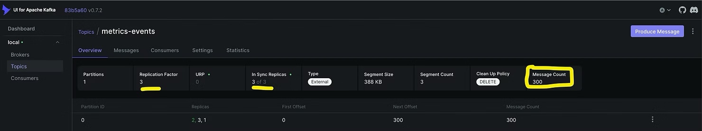
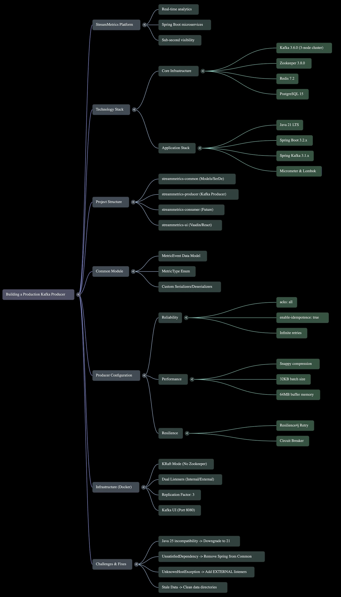

**Part 1 of the StreamMetrics Series**

*Previous parts: *[*Part 2: Consumer + DLQ*](posts/building-production-grade-kafka-consumer-patterns)* | *[*Part 3: Real-Time Aggregations*](posts/real-time-aggregations-with-kafka-streams-at-10k-events-sec)* | *[*Part 4: From Localhost to Kubernetes*](posts/from-localhost-to-kubernetes-deploying-streammetrics-at-scale)*

Love how it rhymes "Production Kafka Producer".

Here's to coding in an era of AI Agents. They suggest and are confident that this time it will work, but then this cluster has its own plan, and it starts misbehaving -- sometimes listens, and on others, feels cornered by his other siblings. This is the ***Tale*** of making the brothers listen and show how the configurations works when we enter the world of multi-node cluster in Kafka and Spring. 

## Stream Metrics:

StreamMetrics is a real-time analytics platform that processes application metrics from multiple Spring Boot microservices using Kafka, providing sub-second visibility into system health and performance. 

So, Objective for this post is to establish a 3 node Kafka cluster, which enable the Producer to produce some messages. Consumer will come later in this series. 

### **Technology Stack**

#### **Core Infrastructure**
* Kafka: 3.6.0 (Multi-broker cluster)
* Zookeeper: 3.8.0 (Kafka dependency)
* Redis: 7.2 (In-memory cache)
* PostgreSQL: 15 (Time-series extension)

#### **Application Stack**
* Java: 21 (LTS)
* Spring Boot: 3.2.x
* Spring Kafka: 3.1.x
* Kafka Streams: 3.6.x
* Spring Data JPA: Latest
* Spring Data Redis: Latest

#### **Supporting Tools**
* Docker & Docker Compose: Local dev environment
* Testcontainers: Integration testing
* JUnit 5: Unit testing
* Micrometer: Metrics collection
* Lombok: Reduce boilerplate

### Project Structure:

### **Main Module:**

This is the main module, which will have sub modules like:
* streammetric-common (common module - which contains the sede)
* streammetric-producer (Kafka Producer)
* streammetric-consumer (Kafka Consumer)
* streammetric-query (Query Layer)
* streammetric-ui (Vaadin or React UI)

Here is the pom file for this module:

```java
<parent>
        <groupId>org.springframework.boot</groupId>
        <artifactId>spring-boot-starter-parent</artifactId>
        <version>4.0.2</version>
    </parent>

    <groupId>org.backendbrilliance</groupId>
    <artifactId>streammetrics</artifactId>
    <version>0.0.1-SNAPSHOT</version>
    <packaging>pom</packaging>

    <modules>
        <module>streammetrics-common</module>
        <module>streammetrics-producer</module>
<!--        <module>streammetrics-consumer</module>-->
<!--        <module>streammetrics-query</module>-->
<!--        <module>streammetrics-ui</module>-->
    </modules>
```

#### Challenges:
* **Issue:** Using Java 25 (early access) caused ***TypeTag::UNKNOWN*** compilation errors
* **Root cause:** Maven compiler plugin + Lombok incompatibility
* **Fix:** Downgraded to Java 21 LTS

### **streammetrics-common module:**

This is the simple spring boot application where we define the models and the (sede) se/de-serializers for our Kafka.

We have following modules defined:
* MetricEvent (message for Kafka)
* MetricType (Enum, which tells what kind of MetricEvent it is sending)

Lets check the pom.xml for common module:

```java
<parent>
        <groupId>org.backendbrilliance</groupId>
        <artifactId>streammetrics</artifactId>
        <version>0.0.1-SNAPSHOT</version>
    </parent>

    <artifactId>streammetrics-common</artifactId>

    <properties>
        <java.version>21</java.version>
        <kafka.version>4.1.1</kafka.version>
    </properties>

    <dependencies>
        <dependency>
            <groupId>org.springframework.boot</groupId>
            <artifactId>spring-boot-starter</artifactId>
        </dependency>
        <dependency>
            <groupId>org.projectlombok</groupId>
            <artifactId>lombok</artifactId>
            <optional>true</optional>
        </dependency>
        <dependency>
            <groupId>com.fasterxml.jackson.core</groupId>
            <artifactId>jackson-databind</artifactId>
        </dependency>
        <dependency>
            <groupId>com.fasterxml.jackson.datatype</groupId>
            <artifactId>jackson-datatype-jsr310</artifactId>
        </dependency>
        <dependency>
            <groupId>jakarta.validation</groupId>
            <artifactId>jakarta.validation-api</artifactId>
        </dependency>
        <dependency>
            <groupId>org.apache.kafka</groupId>
            <artifactId>kafka-clients</artifactId>
            <version>${kafka.version}</version>
        </dependency>
        <dependency>
            <groupId>org.junit.jupiter</groupId>
            <artifactId>junit-jupiter</artifactId>
            <scope>test</scope>
        </dependency>
    </dependencies>
```

Here is the MetricEvent (Using lombok to avoid boiler-plate code)

```java
/**
 * Represents a single metric event in the system.
 * This is the core data model sent through Kafka.
 */
@Data
@Builder
@NoArgsConstructor
@AllArgsConstructor
public class MetricEvent {

    @NotBlank(message = "Event ID cannot be blank")
    @JsonProperty("event_id")
    private String eventId;

    @NotNull(message = "Timestamp cannot be null")
    @JsonProperty("timestamp")
    private Instant timestamp;

    @NotBlank(message = "Service ID cannot be blank")
    @JsonProperty("service_id")
    private String serviceId;

    @NotBlank(message = "Instance ID cannot be blank")
    @JsonProperty("instance_id")
    private String instanceId;

    @NotNull(message = "Metric type cannot be null")
    @JsonProperty("metric_type")
    private MetricType metricType;

    @NotBlank(message = "Metric name cannot be blank")
    @JsonProperty("metric_name")
    private String metricName;

    @NotNull(message = "Value cannot be null")
    @Positive(message = "Value must be positive")
    @JsonProperty("value")
    private Double value;

    @JsonProperty("unit")
    private String unit;

    @JsonProperty("tags")
    private Map<String, String> tags;

    @JsonProperty("metadata")
    private Map<String, String> metadata;
}
```

And this is MetricType Enum:

```java
public enum MetricType {
    HTTP_REQUEST,
    DATABASE_QUERY,
    CACHE_HIT,
    CACHE_MISS,
    EXTERNAL_API_CALL,
    MESSAGE_QUEUE_PUBLISH,
    MESSAGE_QUEUE_CONSUME,
    CUSTOM_COUNTER,
    CUSTOM_GAUGE,
    CUSTOM_HISTOGRAM
}
```

Then comes the serializers and deserializers which will be mapped to Kafka configuration.

The Serializer will import `org.apache.kafka.common.serialization.Serializer` and Deserializer will import `org.apache.kafka.common.serialization.Deserializer`.


#### Challenges:
* **Issue:** `UnsatisfiedDependencyException` - Spring trying to autowire beans in common module
* **Root cause:** Common module had Spring Boot dependencies (should be plain Java library)
* **Fix:** Removed Spring dependencies from common, moved tests to producer

### **streammetric-producer module:**

This module is the Kafka producer, that will be produce the messages to different topics. 
- Define the ProducerFactory
- Create KafkaTemplate

#### ProducerFactory:


Kafka Template:
```java
@Bean
    public KafkaTemplate<String, MetricEvent> kafkaTemplate() {
        return new KafkaTemplate<>(producerFactory());
    }
```

Then we will use the kafkaTemplate to send the data to specific topic.


#### Retry Implementation:

> This annotation can be applied to a class or a specific method. Applying it on a class is equivalent to applying it on all its public methods. The annotation enables backend retry for all methods where it is applied. Backend retry is performed via a retry. If using Spring, name and fallbackMethod can be resolved using Spring Expression Language (SpEL).

#### CircuitBreaker:

> This annotation can be applied to a class or a specific method. Applying it on a class is equivalent to applying it on all its public methods. The annotation enables backend monitoring for all methods where it is applied. Backend monitoring is performed via a circuit breaker. See io.github.resilience4j.circuitbreaker.CircuitBreaker for details. If using Spring, name and fallbackMethod can be resolved using Spring Expression Language (SpEL).

This producer will send the message and logs it, without doing much for now. 

Lets check the application.yml configuration needed with a 3 node cluster.

```java
spring:
  application:
    name: streammetrics-producer

  kafka:
    bootstrap-servers: localhost:9092,localhost:9094,localhost:9096
    producer:
      # Serializers
      key-serializer: org.apache.kafka.common.serialization.StringSerializer
      value-serializer: org.backendbrilliance.streammetrics.serde.MetricEventSerializer

      # Reliability settings
      acks: all
      retries: 2147483647  # Infinite retries
      max-in-flight-requests-per-connection: 5
      enable-idempotence: true

      # Performance tuning
      compression-type: snappy
      batch-size: 32768  # 32KB
      linger-ms: 10
      buffer-memory: 67108864  # 64MB

      # Timeout settings
      request-timeout-ms: 30000
      delivery-timeout-ms: 120000

      # Additional properties
      properties:
        max.block.ms: 60000
```

Check the performance tuning part, where the batch size is defined with the compression type for each message. This restricts a huge message blocking others. 

The bootstrap servers are the three nodes of the Kafka cluster. 

The circuit breaker and retry mechanism can be configured like this:

```java
resilience4j:
  retry:
    instances:
      kafkaProducer:
        max-attempts: 3
        wait-duration: 1s
        exponential-backoff-multiplier: 2
        retry-exceptions:
          - org.apache.kafka.common.errors.NetworkException
          - org.apache.kafka.common.errors.TimeoutException
        ignore-exceptions:
          - org.apache.kafka.common.errors.SerializationException
  circuitbreaker:
    instances:
      kafkaProducer:
        failure-rate-threshold: 50
        wait-duration-in-open-state: 10s
        sliding-window-size: 10
        minimum-number-of-calls: 5
        permitted-number-of-calls-in-half-open-state: 3
```

The naming is self explanatory. If more info is needed, check the official [documentation](https://docs.spring.io/spring-kafka/reference/kafka.html).

Now, lets talk about the `elephant` in the room. 

Since we are creating a Kafka cluster with 3 nodes, we need to define the Kafka network, port mapping, advertised listeners, clusterId, replication factor which are mandatory for the cluster to work properly. 

Here is the part of docker-compose file, which configures Kafka Node1:

```java
services:
  kafka1:
    image: confluentinc/cp-kafka:7.8.0
    hostname: kafka1
    container_name: kafka1
    ports:
      - "9092:9092"
      - "9093:9093"
    environment:
      KAFKA_NODE_ID: 1
      KAFKA_BROKER_ID: 1
      KAFKA_PROCESS_ROLES: 'broker,controller'
      KAFKA_CONTROLLER_QUORUM_VOTERS: '1@kafka1:9093,2@kafka2:9093,3@kafka3:9093'
      KAFKA_LISTENERS: 'PLAINTEXT://kafka1:19092,EXTERNAL://0.0.0.0:9092,CONTROLLER://kafka1:9093'
      KAFKA_ADVERTISED_LISTENERS: 'PLAINTEXT://kafka1:19092,EXTERNAL://localhost:9092'
      KAFKA_LISTENER_SECURITY_PROTOCOL_MAP: 'PLAINTEXT:PLAINTEXT,EXTERNAL:PLAINTEXT,CONTROLLER:PLAINTEXT'
      KAFKA_CONTROLLER_LISTENER_NAMES: 'CONTROLLER'
      KAFKA_INTER_BROKER_LISTENER_NAME: 'PLAINTEXT'
      CLUSTER_ID: 'EmptNWtoR4GGWx-BH6nGLQ'
      KAFKA_OFFSETS_TOPIC_REPLICATION_FACTOR: 3
      KAFKA_GROUP_INITIAL_REBALANCE_DELAY_MS: 0
      KAFKA_DEFAULT_REPLICATION_FACTOR: 3
      KAFKA_MIN_INSYNC_REPLICAS: 2
    volumes:
      - ./kafka1/data:/var/lib/kafka/data
    networks:
      - streammetrics-network
```

Here
* **PLAINTEXT** on port 19092 (internal, broker-to-broker communication)
* **EXTERNAL** on port 9092 (external, for host machine via [localhost](http://localhost))
* **CONTROLLER** on port 9093 (for KRaft consensus)

Refer to my [Github repo](https://github.com/ankitagrahari/StreamAnalytics) to get the entire docker-compose.yml file to setup the 3 node kafka cluster. 

#### Challenges Faced:
- **Issue:** UnknownHostException: kafka1,2,3, then Connection to node could not be established
- **Root causes:**
  - Kafka containers advertising internal hostnames (kafka1:9092) instead of [localhost](http://localhost)
  - Missing EXTERNAL listeners for host machine access
  - Port mapping mismatch (9094:9092 instead of 9094:9094)
- **Fix:** Added dual listeners (INTERNAL for broker-to-broker, EXTERNAL for [localhost](http://localhost))

Another issue was with Stale data 
* **Issue:** DUPLICATE_BROKER_REGISTRATION errors
* **Root cause:** Old cluster metadata in /data directories
* **Fix:** Cleaned kafka1/2/3 data directories before restart

### **Kafka UI**

We have setup Kafka UI also to refer for all the brokers assigned, topics created and the messages producer vs consumed. 

Can be accessed via: [http://localhost:8080/ui/clusters/local/brokers](http://localhost:8080/ui/clusters/local/brokers)

This is how we setup Kafka-UI through docker-compose:

```java
kafka-ui:
    image: provectuslabs/kafka-ui:latest
    container_name: kafka-cluster-ui
    ports:
      - "8080:8080"
    environment:
      KAFKA_CLUSTERS_0_NAME: local
      KAFKA_CLUSTERS_0_BOOTSTRAPSERVERS: kafka1:19092,kafka2:19092,kafka3:19092
      DYNAMIC_CONFIG_ENABLED: 'true'
    depends_on:
      - kafka1
      - kafka2
      - kafka3
    networks:
      - streammetrics-network
```

This is the Kafka UI after producer sends 300 messages:



## **Outcome: ✅ Success**
* **3-broker Kafka cluster** running in KRaft mode (no Zookeeper)
* **Producer sending messages** with idempotent + exactly-once semantics
* **300+ messages** verified in Kafka UI
* **Replication factor: 3**, min in-sync replicas: 2
* **Custom serializers** working (MetricEventSerializer)
* **Project structure** properly set up (parent + common + producer modules)

Next part will have the Kafka consumer with manual offset commits, implement dead letter queue for failed messages and proper error handling and test end to end producer --> consumer flow. 

You can find my
- Github: https://github.com/ankitagrahari
- Instagram: https://www.instagram.com/backendbrilliance/
- Medium: https://medium.com/@ankitagrahari.rkgit

Share your thoughts whether you liked or disliked it. Do let me know if you having any queries or suggestions. 
Never forget, Learning is the primary goal. 

Learn with every commit.