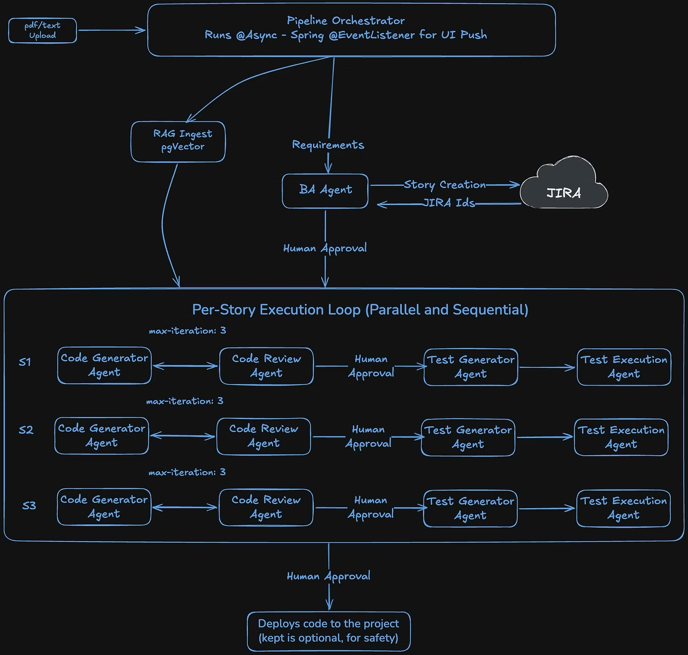
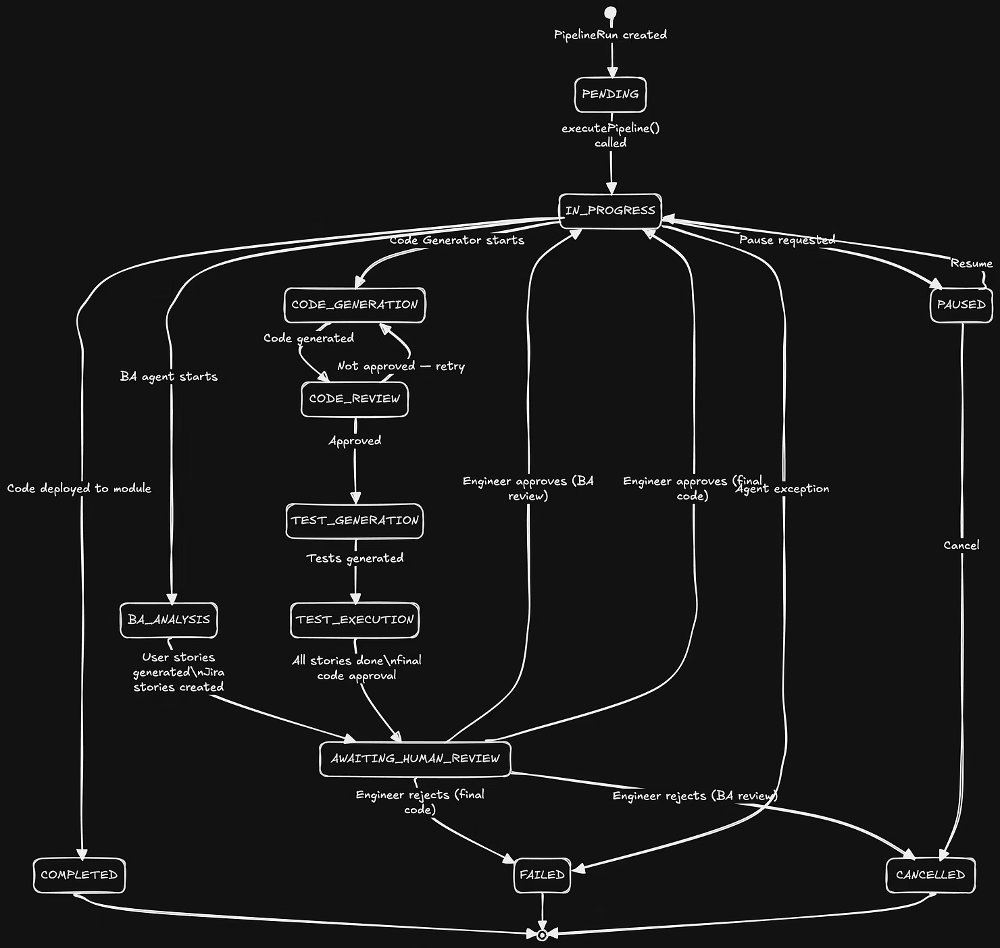

> **TL;DR** — CodeForgeAI is a Spring Boot + Vaadin application that orchestrates five specialised AI agents (Business Analyst → Code Generator → Code Reviewer → Test Generator → Test Executor) to transform a PDF requirements document into reviewed, tested, and deployed Java code — all running on-premise on a developer laptop, with no cloud LLM calls, no data leaving the machine.

## **Table of Contents**

1. Motivation & Goals
2. Tech Stack
3. End-to-End Pipeline Architecture
    1. The 5 Agents — Deep Dive
    2. Business Analyst Agent
    3. Code Generator Agent
    4. Code Review Agent
    5. Test Generator Agent
    6. Test Executor Agent
4. RAG: Codebase Ingestion & Vector Store
5. The Hardest Part: Running Multiple LLMs Locally via Ollama
    1. Hardware Constraints
    2. Models We Evaluated
    3. The num_ctx Uniformity Breakthrough
    4. Final Model Decision
    5. Ollama Environment Variables That Mattered
6. Challenges We Solved
7. Code Structure
8. Real-Time UI with Vaadin & Server Push
9. Jira Integration
10. Human-in-the-Loop Checkpoints
11. What We Learned

## **1. Motivation & Goals**

Generative AI is reshaping software development, but most AI coding tools are cloud-hosted, meaning proprietary code is sent to external servers. For enterprise environments where source code must never leave the network, that's a hard blocker.

We set out to answer a specific question: **Can a fully local, open-weight LLM pipeline produce production-quality Java code, tests, and Jira stories from a requirements PDF — without a single API call to a cloud provider?**

The constraints were deliberate:
* **100% on-premise** — Ollama on a developer laptop, no external model APIs.
* **Agentic pipeline** — not a single mega-prompt, but a chain of specialised agents, each with its own role, prompt, and review loop.
* **Real codebase awareness** — the pipeline reads the existing target module's source, ingests it into a vector store, and generates code that fits the existing structure.
* **Human review gates** — the pipeline pauses at key stages so an engineer can approve before code is written to disk.

## **2. Tech Stack**


| **Layer** | **Technology** |
| --- | --- |
| Backend framework | Spring Boot 3.4, Java 21 |
| AI integration | Spring AI (Ollama backend) |
| Local LLM runtime | Ollama 0.6 |
| Vector store | PostgreSQL + PGVector (HNSW index, cosine distance) |
| Embedding model | nomic-embed-text (768-dim) |
| Primary LLM | qwen2.5-coder:7b-instruct (Q4_K_M, ~4.7 GB) |
| Frontend | Vaadin Flow 24 (server-side Java UI, Lumo theme) |
| Database | PostgreSQL 16 |
| Connection pool | HikariCP (keepalive-tuned for long LLM calls) |
| Issue tracking | Jira Cloud REST API v3 |
| Build | Maven 3 |


## **3. End-to-End Pipeline Architecture**


### **Status State Machine**


## **4. The 5 Agents — Deep Dive**

### **4.1 Business Analyst Agent**

The BA agent reads the raw requirements text and returns a structured JSON array of user stories, each with a title, description in "As a / I want / So that" format, acceptance criteria, and test case specs.

**The core challenge** was that small 7B models regularly wrap JSON in markdown fences, add preamble text like "Sure, here are your user stories:", or append trailing commentary. We built a four-layer extraction strategy:

```java
// From: BusinessAnalystAgent.java
private String extractJson(String response) {
    // Layer 1: markdown-fenced JSON  ─ ```json [...] ```
    Matcher markdownMatcher = MARKDOWN_JSON_PATTERN
               .matcher(response);
    if (markdownMatcher.find()) {
        return markdownMatcher.group(1).trim();
    }
    // Layer 2: bare JSON array anywhere in the text
    Matcher jsonMatcher = JSON_ARRAY_PATTERN.matcher(response);
    if (jsonMatcher.find()) {
        return jsonMatcher.group().trim();
    }
    // Layer 3: whole response is already a JSON array
    String trimmed = response.trim();
    if (trimmed.startsWith("[") && trimmed.endsWith("]")) {
        return trimmed;
    }
    // Layer 4: bracket-matching fallback — find first '[' and last ']'
    int firstBracket = trimmed.indexOf('[');
    int lastBracket  = trimmed.lastIndexOf(']');
    if (firstBracket >= 0 && lastBracket > firstBracket) {
        String candidate = trimmed.substring(firstBracket, lastBracket + 1);
        if (candidate.contains("{")) return candidate;
    }
    return null;
}
```

On parsing failure the agent retries with a strengthened prompt:

```java
// From: BusinessAnalystAgent.java — retry reinforcement
if (attempt > 0) {
    prompt = prompt + "\n\nREMINDER: You MUST output ONLY a JSON array starting "
           + "with [ and ending with ]. Do NOT say anything else. "
           + "Do NOT introduce yourself. Just output the JSON array of user stories.";
}
```

**BA prompt template** ([ba-user-story-generator.st](http://ba-user-story-generator.st)):

```java
Analyze the following software requirements document and generate User Stories.

=== START OF REQUIREMENTS DOCUMENT ===
{requirements}
=== END OF REQUIREMENTS DOCUMENT ===

Based on the requirements above, generate a complete set of User Stories.
Each story must have a title, description (As a... I want... So that...),
acceptance criteria, and test cases.

You MUST respond with ONLY a JSON array. No other text, no explanations,
no markdown fences.

The JSON array must use this exact structure:
[
  {
    "title": "Short descriptive title",
    "description": "As a [role], I want [feature], so that [benefit].",
    "acceptanceCriteria": [
      "Given [context], When [action], Then [outcome]"
    ],
    "testCases": [
      {
        "title": "Test case title",
        "steps": "1. Step one\n2. Step two",
        "expectedResult": "Expected outcome description"
      }
    ]
  }
]
```

### **4.2 Code Generator Agent**

The code generator is the most complex agent. It runs in three distinct modes:

#### **Mode 1: Planning Phase**

Before any code is generated, a lightweight LLM call produces a file plan — a numbered list of every file that needs to be created or modified across all stories. This prevents cross-story inconsistencies like two stories each creating a [BookService.java](http://BookService.java) that overwrite each other.

```java
// From: CodeGeneratorAgent.java
public void runPlanningPhase(PipelineContext context) {
    String prompt = planPromptTemplate
        .replace("{projectStructure}",    context.getProjectStructure())
        .replace("{existingSourceSummary}", context.getExistingSourceSummary())
        .replace("{requirements}",       context.getOriginalRequirements())
        .replace("{userStories}",        context.getUserStoriesJson());

    String planOutput = chatClient.prompt().user(prompt).call().content();
    context.setGenerationPlan(planOutput.trim());
}
```

#### **Mode 2: Per-Story Code Generation (the Signatures-Index Trick)**

Instead of passing full accumulated code between stories (which blows past the 16,384-token context window after just 2–3 stories), we pass only **method signatures** — a condensed index showing class names, field declarations, and method signatures without bodies:

```java
// From: CodeGeneratorAgent.java
public String buildAccumulatedCodeIndex(Map<String, String> fileMap) {
    StringBuilder sb = new StringBuilder();
    for (Map.Entry<String, String> entry : fileMap.entrySet()) {
        sb.append("// === FILE: ").append(entry.getKey()).append(" ===\n");

        String content = entry.getValue();
        // Include: package declaration
        Matcher pkgMatcher = PACKAGE_DECLARATION.matcher(content);
        if (pkgMatcher.find()) sb.append(pkgMatcher.group()).append("\n");

        // Include: class/interface declaration line only
        Matcher classMatcher = CLASS_NAME_EXTRACT.matcher(content);
        if (classMatcher.find()) {
            int classStart = classMatcher.start();
            int lineStart  = content.lastIndexOf('\n', classStart) + 1;
            int lineEnd    = content.indexOf('\n', classStart);
            String classLine = content.substring(lineStart, lineEnd < 0 ? content.length() : lineEnd).trim();
            sb.append(classLine.replaceAll("\\{.*$", "{")).append("\n");
        }

        // Include: public/protected method signatures only (no bodies)
        Matcher methodMatcher = PUBLIC_METHOD_PATTERN.matcher(content);
        while (methodMatcher.find()) {
            String sig = methodMatcher.group().trim().replaceAll("\\{\\s*$", ";");
            sb.append("    ").append(sig).append("\n");
        }
        sb.append("}\n");
    }
    return sb.toString();
}
```

This reduces a 4,000-line accumulated codebase to ~200 lines of signatures, keeping every per-story prompt well within budget.

#### **Mode 3: Feedback Loop Regeneration**

When the AI code reviewer rejects a story's code, the generator gets a focused regeneration prompt containing the previous code + the specific issues found:

```java
// From: CodeGeneratorAgent.java
public String regenerateStoryWithFeedback(
            PipelineContext context, 
            UserStory story,
            String previousStoryCode, 
            String feedback,
            Map<String, String> accumulatedFiles) {
    // Per-story feedback: no truncation needed since context is small (single story)
    String prompt = perStoryFeedbackPromptTemplate
        .replace("{previousStoryCode}", previousStoryCode)
        .replace("{feedback}",          feedback)
        ...;
    log.info("Per-story feedback prompt size: {} chars (no truncation needed).", prompt.length());
    return extractCode(chatClient.prompt().user(prompt).call().content());
}
```

#### **Handling Truncated Output**

7B models regularly hit their num_predict token limit mid-method, producing code with more { than }. We detect and auto-repair:

```java
// From: CodeGeneratorAgent.java
long openBraces  = code.chars().filter(c -> c == '{').count();
long closeBraces = code.chars().filter(c -> c == '}').count();
if (openBraces > closeBraces) {
    log.warn("Generated code appears TRUNCATED: {} open braces, {} close braces.",
             openBraces, closeBraces);
    StringBuilder sb = new StringBuilder(code);
    for (long i = 0; i < openBraces - closeBraces; i++) sb.append("\n}");
    code = sb.toString();
    log.info("Auto-closed {} missing braces.", openBraces - closeBraces);
}
```

The per-story prompt template enforces strict output format:

```java
CRITICAL OUTPUT FORMAT — READ CAREFULLY:
Your ENTIRE response must be a single ```java code block containing ALL files.
Do NOT write ANY text, commentary, analysis, or explanations outside the code block.
Start your response IMMEDIATELY with ```java and end with ```.
If you write plain text instead of code, you have FAILED the task.
```

### **4.3 Code Review Agent**

The reviewer runs a two-layer check: first a deterministic structural pre-validation, then an LLM-powered semantic review.

**Structural pre-validation** catches the most common generator failures before invoking the (expensive) LLM call:

```java
// From: CodeReviewAgent.java
private List<String> validateStructure(String code) {
    List<String> issues = new ArrayList<>();

    if (!code.contains("// === FILE:")) {
        issues.add("No FILE separators found. The code generator must separate each "
                 + "class with a FILE separator for proper deployment.");
    }
    if (!code.contains("package ")) {
        issues.add("No package declarations found. Every Java file must have a package.");
    }
    long openBraces  = code.chars().filter(c -> c == '{').count();
    long closeBraces = code.chars().filter(c -> c == '}').count();
    if (openBraces != closeBraces) {
        issues.add(String.format("Unbalanced braces: %d open '{' vs %d close '}'.",
                                 openBraces, closeBraces));
    }
    if (!code.contains("import ")) {
        issues.add("No import statements found.");
    }
    return issues;
}
```

The LLM is asked to return a structured JSON verdict:

```java
{
  "approved": false,
  "issues": ["Missing @RestController annotation", "findById returns raw Optional"],
  "suggestions": "Add proper ResponseEntity wrapping and null handling."
}
```

We use a brace-counting JSON extractor (not regex) to reliably parse nested JSON from noisy LLM output:

```java
// From: CodeReviewAgent.java
private String extractJson(String text) {
    Matcher startMatcher = JSON_START_PATTERN.matcher(text); // looks for {"approved"
    if (!startMatcher.find()) return null;

    int start = startMatcher.start();
    int depth = 0;
    boolean inString = false, escaped = false;

    for (int i = start; i < text.length(); i++) {
        char c = text.charAt(i);
        if (escaped)         { escaped = false; continue; }
        if (c == '\\' && inString) { escaped = true; continue; }
        if (c == '"')        { inString = !inString; continue; }
        if (!inString) {
            if (c == '{') depth++;
            else if (c == '}') { depth--; if (depth == 0) return text.substring(start, i + 1); }
        }
    }
    return null;
}
```

**Safety-first default**: if JSON parsing fails entirely, the reviewer defaults to approved = false — preventing bad code from being deployed.

### **4.4 Test Generator Agent**

For each story, the test generator receives the generated Java code, the user story with its BA-authored test case specs, and the project structure. It produces JUnit 5 tests with AssertJ assertions and Mockito mocking, placed in the correct test package.

```java
// From: TestGeneratorAgent.java — per-story prompt
String prompt = """
    Generate comprehensive JUnit 5 unit tests for the following Java source code.
    
    === PROJECT STRUCTURE ===
    %s
    
    === SOURCE CODE ===
    %s
    
    === USER STORY REQUIREMENTS ===
    %s
    
    Generate tests that verify the code fulfills the user story requirements.
    Place test classes in the appropriate test package matching the source package structure.
    Include edge cases, boundary values, and error scenarios.
    Use AssertJ assertions and Mockito for mocking where appropriate.
    """.formatted(projectStructure, storyCode, requirements.toString());
```

### **4.5 Test Executor Agent**

The Test Executor compiles all accumulated code and tests together (using cross-story dependencies) in a temporary directory and runs the tests via the Maven Surefire plugin. It captures stdout/stderr and parses pass/fail counts:

```java
// From: PipelineOrchestrator.java — per-story test execution
String allCode = codeGeneratorAgent.buildAccumulatedCodeString(accumulatedFiles);
TestExecutionResult testResult = testExecutorAgent.executeForStory(allCode, result.getGeneratedTests());

result.setCompilationSuccess(testResult.compiled());
result.setTestsRun(testResult.testsRun());
result.setTestsPassedCount(testResult.testsPassed());
result.setTestsFailedCount(testResult.testsFailed());
```

## **5. RAG: Codebase Ingestion & Vector Store**

Before any code generation begins, the target module's entire source tree is ingested into PGVector using nomic-embed-text embeddings. This gives the Code Generator real context about the existing architecture.

**Fingerprint-based cache** — re-ingestion only happens when files actually change:

```java
// From: CodebaseIngestionService.java
private String computeFingerprint(List<Path> files) {
    StringBuilder sb = new StringBuilder();
    for (Path file : files) {
        sb.append(file.toAbsolutePath())
          .append(':')
          .append(Files.getLastModifiedTime(file).toMillis())
          .append(';');
    }
    MessageDigest digest = MessageDigest.getInstance("SHA-256");
    byte[] hash = digest.digest(sb.toString().getBytes(StandardCharsets.UTF_8));
    return HexFormat.of().formatHex(hash).substring(0, 16);
}
```

**Two context modes** — for small codebases (<10 KB total source), the full file content is passed. For larger codebases, we extract signatures only:

```java
// From: CodebaseIngestionService.java
boolean fullMode = totalChars < 10_000;
log.info("Building source summary for {} Java files ({}KB total, mode={})",
         javaFiles.size(), totalChars / 1024, fullMode ? "FULL" : "SIGNATURES");
```

Chunking with TokenTextSplitter:

```java
TokenTextSplitter splitter = TokenTextSplitter.builder()
    .withChunkSize(800)
    .withMinChunkSizeChars(100)
    .withMinChunkLengthToEmbed(50)
    .withMaxNumChunks(200)
    .withKeepSeparator(true)
    .build();
```

RAG retrieval is configured in [AiConfig.java](http://AiConfig.java):

```java
// From: AiConfig.java — only the Code Generator uses RAG
.defaultAdvisors(QuestionAnswerAdvisor.builder(vectorStore)
    .searchRequest(SearchRequest.builder().topK(8).build())
    .build())
```

The Code Review and BA agents deliberately do **not** use RAG — the review agent needs to be objective about the generated code, and injecting random source embeddings into the BA agent's prompt confused the model.

## **6. The Hardest Part: Running Multiple LLMs Locally via Ollama**

This section is the heart of the project. Nothing in the design took more time or produced more surprising failures than the local LLM configuration.

### **6.1 Hardware Constraints**

The development machine is an **Intel Core Ultra 7 265H** with **32 GB RAM**. No discrete GPU. Intel Arc Xe is present but Ollama's llama.cpp backend has no Intel GPU path — everything runs on CPU via AVX2 + AVX_VNNI. That gives roughly **8–12 tokens/second for a 7B Q4_K_M model** and **20–30 tokens/second for a 2B model**.

A full pipeline run with 4 user stories takes **15–25 minutes** on this hardware. That is the price of 100% on-premise.

### **6.2 Models We Evaluated**

We tested six models over the course of the project. The comparison shaped every configuration decision.


| **Model** | **Size** | **Speed (tok/s)** | **Code Quality** | **Decision** |
| --- | --- | --- | --- | --- |
| gemma4:e2b | ~2 GB | 20–30 | ❌ Truncates multi-file output, misses imports | BA only |
| gemma4:e4b | ~9.4 GB | 4–7 | ⚠️ General-purpose, not code-specialised | Rejected |
| deepseek-coder-v2:16b | ~10 GB | 3–5 | ✅ Best code quality | Too slow & too large |
| qwen2.5-coder:7b-instruct | ~4.7 GB | 8–12 | ✅ Best balance | **SELECTED** ✓ |
| nomic-embed-text | ~0.5 GB | n/a | Embedding only | **SELECTED** ✓ |


From the actual Modelfile comments:

```java
# Modelfile.qwen-coder
#
# COMPARISON vs alternatives:
#   gemma4:e2b  (~7.2 GB)   → 20-30 tok/sec BUT truncates multi-file output,
#                            misses imports → USE FOR BA ONLY
#   gemma4:e4b  (~9.4 GB) → 4-7 tok/sec, general-purpose, not code-specialised
#   deepseek-coder-v2:16b → best code quality, ~3-5 tok/sec
#                           (use if quality > speed)
#   qwen-coder:7b (THIS)  → best balance of speed + code quality ✓
```

**Why gemma4:e2b failed for code generation:**

We ran gemma4:e2b on the full code generation pipeline first because its 2B size meant near-instant responses. It failed consistently in three ways: it would stop generating mid-class leaving unbalanced braces, it skipped all import statements (the Jakarta/JPA/Lombok imports that Spring Boot relies on), and it never produced // === FILE: === separators — the convention our pipeline uses to split multi-class output into individual files for deployment. The model simply lacked the depth to hold an entire Spring Boot class hierarchy in its working memory.

**Why deepseek-coder-v2:16b was not selected (despite best quality):**

The code quality was genuinely impressive — better package placement, better REST conventions, more idiomatic Spring patterns. But at 10 GB weight + ~3 tok/sec on this CPU, a single per-story code generation call took 8–12 minutes. A 4-story pipeline would take over an hour. Additionally, we hit a subtle double-BOS (beginning-of-sentence) token bug in Ollama's chat template — documented in Modelfile.deepseek-coder:

```java
# Fixed Modelfile for deepseek-coder-v2:16b
# Change: Removed explicit BOS token from the chat template.
# The llama.cpp tokenizer already adds BOS via add_bos_token=true in the model config.
# Having it in the template too causes the double-BOS warning and degrades generation quality.
```

This required creating a custom Modelfile to strip the duplicated token.

### **6.3 The num_ctx Uniformity Breakthrough**

The single most impactful performance discovery of the project: **Ollama reloads the entire model from disk whenever num_ctx changes between requests.** On a 4.7 GB model over a 20-second cold load, this adds 20–30 seconds to every pipeline stage transition.

Early in development, we had different context windows: BA at 8192, Code Generator at 16384, Code Reviewer at 8192, Test Generator at 12288. Every agent-to-agent handoff forced a model reload. A 4-story pipeline was losing 2–3 minutes to reloads alone.

The fix was to normalise every agent to num_ctx = 16384:

```java
# application.yaml
codeforgeai:
  ollama:
    # Uniform 16384 context window for all agents — avoids Ollama model reloads
    code-num-ctx:   16384
    review-num-ctx: 16384
    test-num-ctx:   16384
    ba-num-ctx:     16384
    # Output limits stay per-agent (these don't cause model reloads)
    code-num-predict:   6144
    review-num-predict: 1024
    test-num-predict:   6144
    ba-num-predict:     2048
```

Memory math for num_ctx = 16384 at Q4_K_M:

```java
KV cache per token = 2 × num_layers × head_dim × bytes_per_element
qwen2.5-coder:7b at 16384 tokens → KV cache ≈ 0.6 GiB  ✓ trivial on 32 GB
```

Total memory budget:

```java
qwen2.5-coder:7b weights (Q4_K_M) : ~4.7 GiB
KV cache (num_ctx=16384)          : ~0.6 GiB
Compute graph overhead            : ~0.3 GiB
nomic-embed-text (always-on)      : ~0.5 GiB
Spring Boot JVM                   : ~1.5 GiB
Windows OS overhead               : ~6.0 GiB
─────────────────────────────────────────────
Total                             : ~13.6 GiB of 32 GiB  ✓ comfortable
Free headroom                     : ~18 GiB
```

### **6.4 Final Model Decision**

One model (qwen2.5-coder:7b-instruct) running all 4 code/review/test agents, uniform num_ctx = 16384. No hot-swap delays. No model reloads between pipeline stages.

Per-agent temperature was tuned separately:

```java
// From: AiConfig.java
// Code Generator — slightly creative but predictable
OllamaChatOptions.builder().temperature(0.3)...

// Code Reviewer — consistent, reproducible JSON verdicts
OllamaChatOptions.builder().temperature(0.2)...

// Test Generator — slightly creative for edge case discovery
OllamaChatOptions.builder().temperature(0.3)...

// BA Agent — deterministic JSON output
OllamaChatOptions.builder().temperature(0.2)...
```

The Modelfile pins temperature to 0.1 at the model level (overridable per-request by the app):

```java
# Modelfile.qwen-coder
PARAMETER temperature 0.1    # Very low: deterministic, reproducible code
PARAMETER num_thread   16    # All 16 threads — AVX2 + AVX_VNNI fast path
PARAMETER num_ctx    16384
PARAMETER num_predict  6144
PARAMETER stop <|im_end|>
PARAMETER stop <|endoftext|>
```

### **6.5 Ollama Environment Variables That Mattered**

```java
# Set permanently in Windows System Environment Variables
OLLAMA_MAX_LOADED_MODELS = 1   # One model hot at a time (single model, no swap)
OLLAMA_NUM_PARALLEL      = 1   # One inference at a time (CPU can't parallelise)
OLLAMA_FLASH_ATTENTION   = 1   # Reduces KV cache memory usage
OLLAMA_KEEP_ALIVE        = 10m # Keep model loaded during pipeline, unload after
```

OLLAMA_FLASH_ATTENTION=1 alone reduced KV cache by ~30% with no measurable quality impact — worth setting on any CPU-bound deployment.

## **7. Challenges We Solved**

### **Challenge 1: LLM Ignores Output Format Instructions**

**Problem**: Even with explicit "respond with only a JSON array" instructions, qwen2.5-coder would prefix responses with "Sure! Here are your user stories:" or wrap output in markdown fences.

**Solution**: Multi-layer extraction (see §4.1) + retry with reinforcement prompt. On second attempt, we append a stern reminder directly to the prompt.

### **Challenge 2: Context Window Overflow on Multi-Story Pipelines**

**Problem**: Story 1 generates [BookController.java](http://BookController.java), [BookService.java](http://BookService.java), and [BookRepository.java](http://BookRepository.java). Story 2 needs to know about all three to avoid duplicate code, but passing them verbatim consumed 60–70% of the context window before the story description even started.

**Solution**: The **signatures-only index** (buildAccumulatedCodeIndex) — pass method signatures only, not method bodies. A 400-line Java class reduces to ~15 lines of signatures.

### **Challenge 3: Truncated Output — Unclosed Braces**

**Problem**: At num_predict = 6144, the model would hit the token limit mid-method:

```java
public List<Book> searchByTitle(String title) {
    return bookRepository.findByTitleContainingIgnoreCase(title);
// <token limit hit — class never closed>
```

**Solution**: Detect truncated code blocks (UNCLOSED_CODE_BLOCK_PATTERN), count { vs }, and auto-close the deficit:

```java
Matcher unclosedMatcher = UNCLOSED_CODE_BLOCK_PATTERN.matcher(response);
if (unclosedMatcher.find()) {
    String truncatedCode = unclosedMatcher.group(1).trim();
    log.warn("Detected TRUNCATED code output. Length: {} chars", truncatedCode.length());
    codeBlocks.add(truncatedCode);
}
```

### **Challenge 4: PostgreSQL "Marked as Broken" Connections**

**Problem**: LLM inference calls run for 3–8 minutes. During that time, HikariCP connections sit idle. PostgreSQL silently drops idle TCP connections after ~5 minutes, leaving Hikari's pool holding dead connections. The next DB write fails with SQLSTATE(08006).

**Solution**: Two-pronged fix in application.yaml:

```java
hikari:
  keepalive-time: 30000       # 30s — sends "SELECT 1" to PG every 30s
  idle-timeout:   600000      # 10 min — return connections before PG drops them
  connection-timeout: 30000
  leak-detection-threshold: 120000  # Warn if connection held > 2 min
```

Combined with TCP keepalives in the JDBC URL:

```java
url: jdbc:postgresql://localhost:5432/codeforgeai?tcpKeepAlive=true&socketTimeout=0&connectTimeout=10
```

### **Challenge 5: deepseek-coder-v2 Double-BOS Token**

**Problem**: Ollama's default chat template for deepseek-coder-v2:16b injected an explicit <｜begin▁of▁sentence｜> token, but llama.cpp also adds it via add_bos_token=true in the model config. The double-BOS produced garbled generation quality.

**Solution**: Custom Modelfile stripping the explicit BOS from the template (Modelfile.deepseek-coder).

### **Challenge 6: Ollama Model Reloads Between Pipeline Stages**

Already described in §6.3. The fix was normalising num_ctx = 16384 across all agents.

### **Challenge 7: LLM Returns Plain Text Instead of Code**

The code generator has a retry path for this:

```java
// From: CodeGeneratorAgent.java
log.warn("LLM returned plain text. Attempting retry with explicit code-only instruction...");
String retryPrompt = "Your previous response was plain text, NOT code. "
    + "Convert the following description into actual Java source code. "
    + "Respond with ONLY a ```java code block. "
    + "No explanations. No commentary. Just code. "
    + "Start EVERY file with: // === FILE: <relative-path-from-src> ===\n"
    + "Start immediately with ```java\n\n"
    + "Here is what you described (convert this to code):\n"
    + response.substring(0, Math.min(4000, response.length()));
```

## **8. Code Structure**
```
codeforgeai/
├── src/main/java/org/epam/codeforgeai/
│   ├── agent/                          # The 5 AI agents
│   │   ├── Agent.java                  # Common interface: execute(PipelineContext)
│   │   ├── BusinessAnalystAgent.java   # Requirements → User Stories JSON
│   │   ├── CodeGeneratorAgent.java     # User Stories → Java source code (839 lines)
│   │   ├── CodeReviewAgent.java        # Java code → JSON review verdict
│   │   ├── TestGeneratorAgent.java     # Java code → JUnit 5 tests
│   │   └── TestExecutorAgent.java      # Compile + run tests, capture results
│   │
│   ├── config/
│   │   ├── AiConfig.java               # 4 ChatClient beans (per-agent model/temp/ctx)
│   │   ├── AppProperties.java          # @ConfigurationProperties for YAML
│   │   ├── AsyncConfig.java            # @Async thread pool for pipeline
│   │   └── VaadinConfig.java           # Vaadin push + session config
│   │
│   ├── event/
│   │   └── PipelineProgressEvent.java  # Spring ApplicationEvent for UI push
│   │
│   ├── model/
│   │   ├── dto/
│   │   │   ├── PipelineContext.java    # Mutable pipeline state (passed agent→agent)
│   │   │   ├── UserStory.java          # BA output: title, description, AC, test cases
│   │   │   ├── StoryPipelineResult.java# Per-story: code, review, tests, exec output
│   │   │   ├── CodeReviewResult.java   # approved, issues[], suggestions
│   │   │   ├── AgentToggles.java       # Feature flags: enableBA, enableDev, etc.
│   │   │   └── TestCaseSpec.java       # Test case: title, steps, expectedResult
│   │   ├── entity/
│   │   │   ├── PipelineRun.java        # JPA: pipeline run with all results
│   │   │   └── AgentExecution.java     # JPA: per-agent timing + status
│   │   └── enums/
│   │       ├── PipelineStatus.java     # PENDING→IN_PROGRESS→...→COMPLETED
│   │       └── AgentType.java          # BA_AGENT, CODE_GENERATOR, etc.
│   │
│   ├── repository/
│   │   ├── PipelineRunRepository.java  # JPA + custom queries
│   │   └── [AgentExecutionRepository.java](http://AgentExecutionRepository.java)
│   │
│   ├── service/
│   │   ├── PipelineOrchestrator.java   # @Async: coordinates all 5 agents (1053 lines)
│   │   ├── PipelineTrackingService.java# Transactional DB writes for pipeline state
│   │   ├── CodebaseIngestionService.java # RAG: walks module, chunks, embeds to PGVector
│   │   ├── CodeDeploymentService.java  # Writes approved Java files to module/src/
│   │   ├── DocumentIngestionService.java # PDF/TXT → raw requirements text
│   │   └── JiraService.java            # Creates Jira stories + test cases via REST
│   │
│   └── ui/                             # Vaadin views
│       ├── MainLayout.java             # AppLayout: sidebar nav + dark mode toggle
│       ├── NewPipelineView.java        # Upload PDF, set agent toggles, start pipeline
│       ├── PipelineDetailView.java     # Real-time pipeline progress (1151 lines)
│       ├── PipelineHistoryView.java    # History grid with results
│       ├── BaPipelineView.java         # BA-only analysis view
│       └── DashboardView.java          # Stats: total runs, pass rate, etc.
│
├── src/main/resources/
│   ├── application.yaml               # All config: Ollama, Hikari, PGVector, Jira
│   └── prompts/
│       ├── ba-system.st               # BA system prompt
│       ├── ba-user-story-generator.st # BA user prompt template
│       ├── code-generator-system.st   # Code gen system prompt
│       ├── code-generator-plan.st     # Planning phase prompt
│       ├── code-generator-per-story.st          # Per-story generation prompt
│       ├── code-generator-per-story-feedback.st # Per-story feedback regen
│       ├── code-generator-with-feedback.st      # Legacy monolithic feedback
│       ├── code-review-system.st      # Code review system prompt
│       └── test-generator-system.st   # Test generator system prompt
│
└── docker/
    ├── Modelfile.qwen-coder            # qwen2.5-coder:7b CPU config
    ├── Modelfile.gemma4                # gemma4:e2b BA-agent config
    └── Modelfile.deepseek-coder        # deepseek-coder-v2:16b (alternative)
```

## **9. Real-Time UI with Vaadin & Server Push**

The UI is built with Vaadin Flow (server-side Java), rendering all components in Java without writing HTML or JavaScript.

**Server Push architecture**: The pipeline runs in a background thread (@Async). To update the browser in real time, each agent call publishes a PipelineProgressEvent using Spring's ApplicationEventPublisher. A static registry in PipelineDetailView maps pipeline run IDs to active browser sessions:

```java
// From: PipelineDetailView.java
private static final Map<UUID, Set<PipelineDetailView>> ACTIVE_VIEWS = new ConcurrentHashMap<>();

@EventListener
public static void onPipelineProgress(PipelineProgressEvent event) {
    Set<PipelineDetailView> views = ACTIVE_VIEWS.get(event.getPipelineRunId());
    if (views == null || views.isEmpty()) return;
    for (PipelineDetailView view : views) {
        if (view.ui != null) {
            view.ui.access(() -> {              // UI.access() → server push to browser
                view.updateStepCard(event.getAgentType(), event.getStatus(), event.getMessage());
                view.updateStatusBadge(event.getStatus());
                view.updateProgressBar(event.getStatus());
                view.loadPipelineData();        // Refresh per-story sections from DB
            });
        }
    }
}
```

**Progress bar** is computed from real story/agent data — not a spinner:

```java
// From: PipelineDetailView.java
// Layout: BA (10%) → Stories (80%) → Final (10%)
// Within each story: code=25% → review=50% → test gen=75% → test exec=100%
double storyWeight = 0.80 / lastKnownTotalStories;
double phaseProgress = switch (lastKnownAgentType) {
    case CODE_GENERATOR -> 0.25;
    case CODE_REVIEWER  -> 0.50;
    case TEST_GENERATOR -> 0.75;
    case TEST_EXECUTOR  -> 1.0;
    default             -> 0.0;
};
double progress = 0.10 + (lastKnownStoryIndex * storyWeight) + (phaseProgress * storyWeight);
```

**Dark mode toggle** uses Vaadin's Lumo theme with VaadinSession persistence:

```java
// From: MainLayout.java
darkModeBtn.addClickListener(e -> {
    var themeList = UI.getCurrent().getElement().getThemeList();
    boolean nowDark = themeList.contains(Lumo.DARK);
    if (nowDark) {
        themeList.remove(Lumo.DARK);
        darkModeBtn.setText("🌙");
        VaadinSession.getCurrent().setAttribute(DARK_MODE_SESSION_KEY, false);
    } else {
        themeList.add(Lumo.DARK);
        darkModeBtn.setText("☀️");
        VaadinSession.getCurrent().setAttribute(DARK_MODE_SESSION_KEY, true);
    }
});
```

## **10. Jira Integration**

After the BA agent generates user stories, JiraService creates Jira issues and links test cases. The pipeline pauses at a human review checkpoint so the engineer can review the created stories in Jira before code generation begins.

```java
// From: PipelineOrchestrator.java — BA human review checkpoint
humanReviewPhase.put(runId, REVIEW_PHASE_BA);
controlSignals.put(runId, PipelineSignal.HUMAN_REVIEW_REQUESTED);

String baReviewMsg = context.getJiraStoryKeys().isEmpty()
    ? "BA analysis complete. Review user stories and approve to proceed."
    : "Jira stories created: " + String.join(", ", context.getJiraStoryKeys())
      + ". Review and approve to proceed.";
publishEvent(runId, AgentType.BA_AGENT, PipelineStatus.AWAITING_HUMAN_REVIEW,
             baReviewMsg, 0, REVIEW_PHASE_BA, context.getJiraStoryKeys());
```

The AppProperties.JiraProperties drives all connection parameters:

```java
// From: AppProperties.java
public static class JiraProperties {
    private String  baseUrl;         // e.g. https://your-domain.atlassian.net
    private String  projectKey;      // e.g. SCRUM
    private String  username;        // email for Jira Cloud
    private String  apiToken;
    private String  storyIssueType = "Task";
    private String  testIssueType  = "Task";
    private String  issueLinkType  = "Relates";
    private boolean enabled        = true;
}
```

## **11. Human-in-the-Loop Checkpoints**

The pipeline has **three** pause points, each waiting for an explicit browser-side approval before proceeding:


| **Checkpoint** | **Phase** | **Purpose** |
| --- | --- | --- |
| 1 | After BA Agent | Review generated user stories in Jira before code generation starts |
| 2 | After all stories processed | Approve final accumulated code before deployment to module |
| (Legacy) 3 | After test generation | Review generated tests before executing them |


Implemented via a cooperative signal map:

```java
// From: PipelineOrchestrator.java
public enum PipelineSignal { RUNNING, PAUSE_REQUESTED, CANCEL_REQUESTED, HUMAN_REVIEW_REQUESTED }

private boolean checkpoint(UUID runId) {
    while (true) {
        PipelineSignal signal = controlSignals.getOrDefault(runId, PipelineSignal.RUNNING);
        switch (signal) {
            case CANCEL_REQUESTED -> {
                trackingService.updateRunStatus(runId, PipelineStatus.CANCELLED);
                controlSignals.remove(runId);
                return false;   // caller returns, pipeline stops
            }
            case PAUSE_REQUESTED, HUMAN_REVIEW_REQUESTED -> {
                trackingService.updateRunStatus(runId, status);
                synchronized (controlSignals) { controlSignals.wait(30_000); }
                // Loop back — re-evaluate signal after wake
            }
            case RUNNING -> { return true; }
        }
    }
}
```

## **12. What We Learned**

**1. Model selection matters more than prompt engineering.** The best prompt in the world cannot make a 2B model reliably produce multi-file Spring Boot code. The jump from gemma4:e2b to qwen2.5-coder:7b removed entire categories of failure (missing imports, missing braces, missing FILE separators) that no prompt reinforcement could fix.

**2. Uniform num_ctx is not optional when running sequential agents.** The 20–30 second model reload delay per stage — invisible during single-agent testing — compounds into minutes across a full pipeline. Always benchmark multi-agent pipelines with realistic stage-to-stage transitions, not individual calls.

**3. Deterministic output requires very low temperature.** Code generation at temperature=0.1–0.3 produces consistent, repeatable output. Higher temperatures generated creative but broken Java — inconsistent method names, invented annotations that don't exist, mismatched parameter types across files.

**4. Never pass full accumulated source to every story prompt.** A signatures-only index is the practical solution to the context window problem. Four stories × 3 Java files × 200 lines each = 2,400 lines. Passed as signatures: ~60 lines. The LLM gets the structural contract without the noise.

**5. Structural pre-validation before LLM review saves tokens.** Running a fast heuristic check for // === FILE:, balanced braces, and package declarations before invoking the Code Review LLM catches ~40% of failures in microseconds instead of the 30–60 seconds an LLM call costs.

**6. The database connection pool needs tuning for LLM workloads.** Standard HikariCP defaults assume fast OLTP queries. LLM pipelines hold transactions open across calls that last minutes. The 30-second keepalive-time and tcpKeepAlive=true in the JDBC URL are not optional.

Refer to the Github account for full code base.

Repo Link:  [https://github.com/ankitagrahari/codeforgeai](https://github.com/ankitagrahari/codeforgeai)

*CodeForgeAI is built on Spring Boot 4.0.x, Spring AI, Vaadin Flow 25, Ollama, and PostgreSQL + PGVector. All LLM inference runs locally via Ollama on an Intel Core Ultra 7 265H with 32 GB RAM — no cloud API calls.*

If you find this tutorial of some use, do comment, and share your thoughts, suggestions. 

Happy learning !!