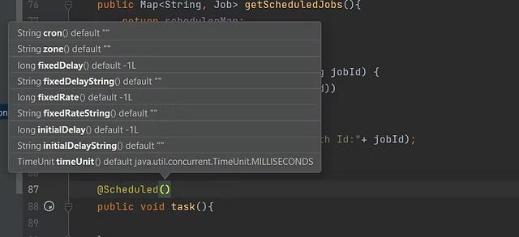

Spring boot provides an easy option of scheduling tasks which will be triggered when the interval or time is right. We can use the @Scheduled annotation to achieve this, but what if we want to schedule the jobs on certain events, or by invoking some services.

Lets say you are working on a project in which you want to schedule your API's to run at 12:00pm every night and collect the data for the entire day and save it to either in database or in some files. There could be multiple task for which you will invoke other API's such as data collection for specific scenarios, or sending notification or updating the status of certain entity when certain event happened etc.

In these scenarios the usual *@Scheduled* annotation will not be very useful, and you might need some dynamic scheduling which can be triggered on the users or customers need. 

### **@Scheduled**

Lets see how the usual way of scheduling works. In your spring boot project, you want to schedule certain task which is to be executed, let's say after every minute, then we can create a service class which will have the method to perform the task and use the @Scheduled annotation, that can be provided with certain arguments 



e.g. cron with every 10 seconds

```java
@Scheduled(cron = "0/10 * * * * *", zone = "Asia/Kolkata")
public void task(){
    System.out.println("Every 10 seconds");
}
```

e.g. fixed delay of 10 seconds

```java
@Scheduled(fixedDelay = 10000)
public void task(){
    System.out.println("Every 10 seconds");
}
```

e.g. fixed rate of 10 seconds

```java
@Scheduled(fixedRate = 10000)
public void task(){
    System.out.println("Every 10 seconds");
}
```

Or you can use the parameterized string, which will take value from *.properties or * yml file.

```java
@Scheduled(fixedDelayString = "${fixedDelay.in.millisec}")
public void task(){
    System.out.println("Every 10 seconds");
}
```

Similarly, *fixedRateString* and *cron* expression can also be used. 

Also, you need to add the *@EnableScheduling* on the Scheduler Configuration file or on the Main class where *@SpringBootApplication* is used.

### **Task Scheduler**

Till now, we were talking about the static scheduling where the user cannot do anything once the application is started. But in normal day to day scenario, we will get tasks which should be maintained by either the user or some events. 

In these scenarios, Spring introduced *TaskScheduler* interface, which will allow the user to maintain the scheduled jobs and provide the much needed flexibility. 

So as part of this blog post, we will create a small project which will on request schedule a Job. This job can be used to call other GET or POST API's that is exposed in your microservices environment. 

The project will have following REST endpoints:
* **Schedule GET API's**:
Type: POST
endpoint: /scheduleGet
payload: Job
description: It will allow user to schedule the Rest API's of GET type.
* **Schedule POST API's:**
Type: POST
endpoint: /schedulePost
payload: Job
description: It will allow user to schedule the Rest API's of POST type.
* **Get all scheduled Jobs:**
Type: GET
endpoint: /scheduledJobs
description: It will allow user to see all the scheduled jobs in this application.
* **Delete any scheduled Jobs:**
Type: DELETE
endpoint: /deleteJob/{jobId}
description: It will allow user to delete any scheduled job running in this application.

#### **Job**

```java
@Data
@AllArgsConstructor
@NoArgsConstructor
@ToString
public class Job {

    private String jobName;
    private String apiURL;
    private String baseURL;
    private String cron;
}
```

This is the payload of the endpoints, which will take the base URL, the API URL which are exposed and the cron expression. Job name is also mandatory to recognize the job.

#### **Scheduler Configuration**

Since we are not using the *@Scheduled* annotation, we have to create the scheduler configuration which will take the *SchedulingConfigurer* interface. The interface will allow to configure the task by providing a overridden method *configureTasks()*.

At this stage, we need the *TaskScheduler* to initialize the scheduler and provide what kind of scheduler we are going to use. We can also define the thread scheduler name and the pool size. 

> Pool size is useful in case we have multiple scheduled jobs clashing to run at same time. If we have multiple threads, then it can be assigned to multiple threads and executed, else if we have only one thread, then the other scheduled job need to wait for it to finish.

So finally my scheduler config class will look like this:

```java
@Configuration
@EnableScheduling
@ConditionalOnProperty(name = "spring.scheduler.enabled")
public class SchedulerConfiguration implements SchedulingConfigurer {

    @Override
    public void configureTasks(ScheduledTaskRegistrar taskRegistrar) {
        taskRegistrar.setTaskScheduler(taskScheduler());
    }

    @Bean
    public TaskScheduler taskScheduler() {
        ThreadPoolTaskScheduler scheduler = new ThreadPoolTaskScheduler();
        scheduler.setPoolSize(poolSize);
        scheduler.setThreadNamePrefix("ThreadScheduler-");
        scheduler.initialize();
        return scheduler;
    }
}
```

If you have noticed, we have used the *@ConditionalOnProperty* annotation which will take a property that can be set in the *application.properties* or *yaml* file. In this case, it will either enable or disable the scheduler we are creating. 

At this point, I have the scheduler configuration set. So, if I call *taskScheduler.schedule()* method with the Runnable task and cron expression, we are done with scheduling a task. 

From here, we will take further to invoke an API which is defined in the payload (*Job*). When we send a request for scheduling any GET API's, the scheduler application will call your GET API following the cron expression passed as payload.

The *scheduledGet* API looks like this:

```java
@PostMapping("/scheduleGet")
public void scheduleGetJob(@RequestBody Job job){
    if(null!=job){
        schedulerService.scheduleGetJob(job);
    }
}
```

All the scheduled jobs are maintained in a Map.

```java
private Map<String, Job> schedulerMap = new HashMap<>();

public void scheduleGetJob(Job job) {
    log.info("scheduling get job:"+ job.toString());
    taskScheduler.schedule(
            () -> {
                ResponseEntity<String> response = webClient.get()
                        .uri(job.getBaseURL() + job.getApiURL())
                        .header("Content-Type", "application/json")
                        .retrieve()
                        .toEntity(String.class)
                        .block();
                if(response.getStatusCode().isError()){
                    log.error("Failure calling Job:"+ job.getJobName()+ "with URL:"+ job.getBaseURL()+job.getApiURL());
                } else {
                    log.info(response.getBody());
                }
            },
            new CronTrigger(job.getCron(), TimeZone.getTimeZone(TimeZone.getDefault().toZoneId()))
    );
    schedulerMap.put(job.getJobName() + "-" + System.currentTimeMillis(), job);
}
```

The *taskScheduler.schedule()* takes a Runnable task, and cron trigger. Here my runnable task is to call the GET API defined in the the payload *Job*. 

If you notice the request body, we are defining the base and API URL and the cron expression. Once this API is invoked, it will schedule the job '*test-get*' which will call the API [*'http://localhost:7887/hello'*](http://localhost:7887/hello) after every 10 seconds.

I designed the */hello* API to print a message

```java
@GetMapping("/hello")
public String sayHello(){
    return "Ola Amigos!";
}
```

Similarly, for scheduling a POST job, we are calling the POST API which takes Job as the payload. The behavior is similar to that of scheduling the GET API. 

These are the logs for the two scheduled Jobs 

Also, we can get all the scheduled jobs using this API, and

Delete any specific scheduled job using this API. 

Hoping this small project will help someone who is looking for dynamic scheduling in spring boot projects. You can find the entire code on my [*Github*](https://github.com/ankitagrahari/Scheduler). Please do suggest more content topics of your choice and share your feedback. Also [*subscribe and appreciate*](https://razorpay.com/payment-button/pl_IKvqCobZrv20Av/view/?utm_source=payment_button&utm_medium=button&utm_campaign=payment_button) the blog if you like it.

#### References
* [*https://riteshshergill.medium.com/dynamic-task-scheduling-with-spring-boot-6197e66fec42*](https://riteshshergill.medium.com/dynamic-task-scheduling-with-spring-boot-6197e66fec42)* *
* *https://crontab.cronhub.io/*