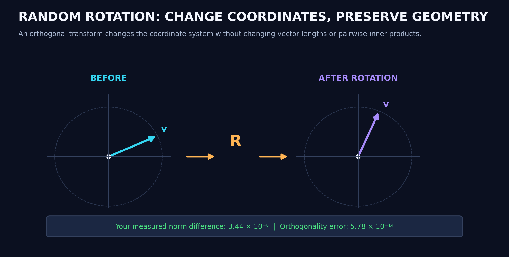
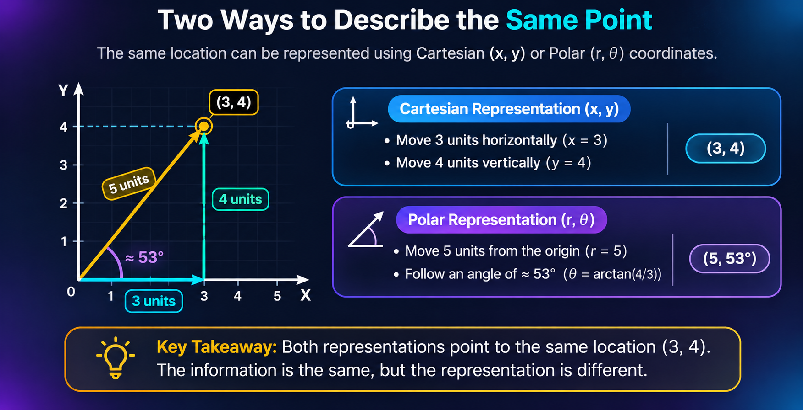
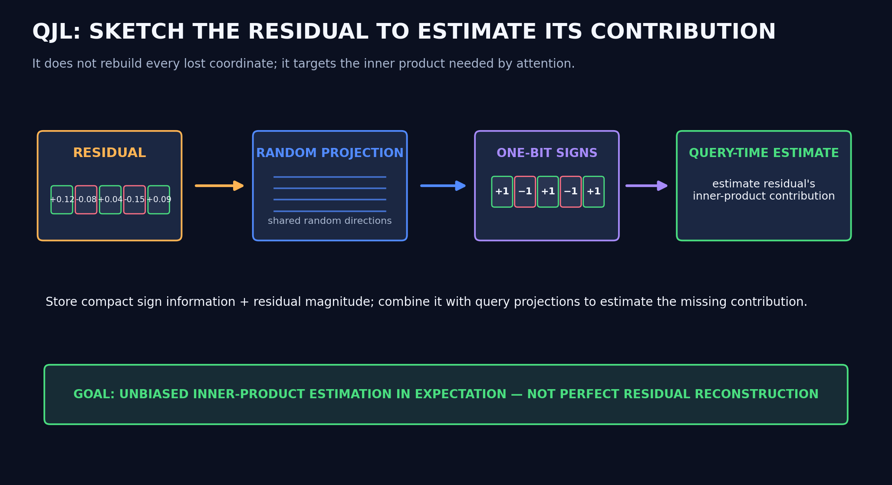
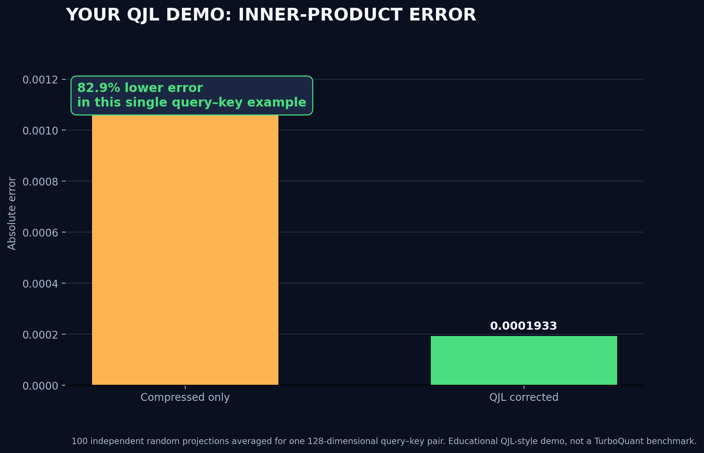

*Understanding vector compression, KV Cache, PolarQuant and QJL through simple explanations and hands-on experiments.*

## Introduction

Have you ever wondered why running an AI model requires so much memory, even when the model itself is already loaded?

One of the reasons is something called the **KV Cache**.

As an AI model processes a conversation, it needs to retain information from previously processed tokens. Rather than calculating everything again for every new token, it stores intermediate information in memory and reuses it.

This makes text generation faster, but it introduces another challenge: the longer the conversation, the more memory the model needs.

Google Research introduced **TurboQuant**, a technique designed to address this problem through extreme vector compression.

The interesting part isn't just that TurboQuant compresses data. It's how it tries to preserve the mathematical information that AI models need even after compression.

In this article, we'll understand the problem from scratch, explore the ideas behind TurboQuant, and perform a few Python experiments to see what happens when we compress vectors ourselves.

You don't need an ML background to follow along. We'll use simple examples and focus on understanding what the results actually mean.

## 1. Why does AI need so much memory?

Let's start with something familiar: a conversation with ChatGPT.

Imagine asking an AI model:

1. Explain Java garbage collection.
2. How does it differ from reference counting?
3. Can you give me an example?
4. How does this affect Spring Boot applications?

The model needs to consider the previous conversation when generating each new response.

Reprocessing everything from scratch would be inefficient.

Transformer models solve this using something called **Key-Value Cache (KV Cache)**.

### What is a KV Cache?

During attention calculations, a Transformer generates two important representations for each token:

- **Key (K):** Represents information that can be matched against a query.
- **Value (V):** Contains information that can be retrieved when that key is relevant.

The model stores these Key and Value representations in memory so they can be reused during subsequent token generation.

Think of it as keeping notes while reading a book.

Instead of reading the entire book again whenever someone asks a question, you refer to the notes you've already created.

That's essentially what the KV Cache helps the model do.

### Why does this become a problem?

As the conversation grows, more tokens need to be represented in the cache.

The memory requirement depends on several factors:

- Number of Transformer layers.
- Number of Key-Value attention heads.
- Dimension of each attention head.
- Number of tokens stored.
- Precision used to store the values.

Long-context models and multiple concurrent requests can make KV Cache memory a significant bottleneck.


This is where compression becomes interesting.

## 2. What is quantization?

Before understanding TurboQuant, let's understand a fundamental concept: quantization.

Imagine storing a numerical value:

`0.123456789`

Do we always need to store all these decimal places?

What if we could represent it approximately as:

`0.12`

We would lose some precision, but we would also need less information to represent the value.

This is the basic idea behind quantization.

In machine learning, numerical values are often stored using different representations:

| Representation | Bits per value |
|---|---:|
| FP32 | 32 |
| FP16 | 16 |
| INT8 | 8 |
| INT4 | 4 |

Reducing the number of bits reduces the amount of storage required.

For example:

- FP32 requires 4 bytes.
- INT8 requires 1 byte.
- INT4 requires half a byte when values are packed efficiently.

However, there is a catch.

**The fewer bits we use, the more carefully we need to preserve the information that matters.**

Consider compressing a photograph. We don't necessarily need every original pixel value, but we still want the photograph to look similar.


Vector compression faces a comparable challenge.

## 3. Why isn't ordinary quantization enough?

Let's consider a simple numerical vector:

`[0.82, 0.45, 0.67, 0.12]`

Suppose we compress it:

`[0.86, 0.43, 0.71, 0.14]`

The reconstructed vector is not identical to the original.

This difference is called **quantization error** or reconstruction error.

For many applications, a small error is acceptable. But consider a vector database or Transformer attention calculation. The relationships between vectors are often more important than the individual numerical values. A small change in coordinates can change similarity rankings or attention scores. Therefore, a good compression technique must consider not just how much memory it saves, but also what information it preserves.

This is the problem TurboQuant attempts to solve.

## 4. Introducing TurboQuant

Google Research introduced TurboQuant in March 2026.


The underlying research paper, *TurboQuant: Online Vector Quantization with Near-optimal Distortion Rate*, was published as an arXiv preprint in April 2025 and was accepted for ICLR 2026.

The research focuses on efficiently compressing high-dimensional vectors without requiring model retraining or a calibration dataset.

The key ideas involve:

1. Random rotation.
2. Efficient scalar quantization.
3. Residual correction using QJL(Quantized Johnson–Lindenstrauss).

Let's understand them individually.

## 5. Random rotation: Changing representation without losing geometry

Imagine a point on a piece of paper. You rotate the paper by 90 degrees. The point's coordinates change, but its distance from the centre remains the same. Random rotation applies a similar mathematical operation to high-dimensional vectors.



For a vector V, we multiply it by an orthogonal matrix R:

> `V' = V × R`

The important property of this matrix is:

> `Rᵀ × R = I`

This means the transformation preserves vector lengths and inner products when applied consistently.

***Why does this help?***

High-dimensional vectors can have uneven coordinate distributions.

Random rotation changes the coordinate representation and makes the resulting coordinates more statistically suitable for efficient scalar quantization.

The goal is to make compression more efficient without losing the important geometric relationships.

### Our first experiment: Verify random rotation

We generated a random vector and an orthogonal matrix using NumPy. We then compared the original vector's length with its rotated version.

```python
# Check orthogonality
identity = np.eye(dimensions)

orthogonality_error = np.linalg.norm(
    rotation_matrix.T @ rotation_matrix - identity
)

print("Orthogonality error:", orthogonality_error)

# Check vector norm preservation
original_norm = np.linalg.norm(sample_vector)
rotated_norm = np.linalg.norm(rotated_vector)

print("Original norm:", original_norm)
print("Rotated norm:", rotated_norm)

print(
    "Norm difference:",
    abs(original_norm - rotated_norm)
)
```

Our result:

| Measurement | Result |
|---|---:|
| Orthogonality error | 5.78 × 10⁻¹⁴ |
| Original vector norm | 1.0 |
| Rotated vector norm | 1.000000034 |

The difference is extremely small and comes from floating-point precision. This confirms that our rotation implementation preserves vector length.

**One important lesson**: rotation changes the coordinates, not the underlying geometry.


## 6. PolarQuant: Making vector compression more efficient

PolarQuant is a related quantization technique presented alongside TurboQuant by Google Research.

Instead of treating every vector coordinate independently in its original Cartesian representation, PolarQuant uses polar-coordinate-based transformations.

Think about describing a location.



You could say:

- Move 3 units horizontally.
- Move 4 units vertically.

Or you could say:

- Move 5 units.
- Follow an angle of approximately 53 degrees.

Both describe the same location, but the representation is different.

PolarQuant uses a related mathematical idea for high-dimensional vectors.

Its recursive polar transformations help represent vector information through radii and angles while reducing the need for conventional per-block normalization metadata.

***Why is this useful?***

Traditional quantization techniques may need additional scale and normalization values for individual blocks. These extra values consume memory and reduce the benefit of compression. PolarQuant aims to reduce that overhead.

The important takeaway:

> **Compression isn't only about reducing the size of the original values. We must also reduce the extra information required to decode them.**

## 7. QJL: What happens to the information lost during compression?

This is one of the most interesting ideas in the research.



Even after carefully designed quantization, some information is lost.

Let's take a simple example:

Original vector:

`[0.8, 0.4, 0.6, 0.2]`

Compressed vector:

`[0.7, 0.5, 0.6, 0.2]`

The difference is:

`[0.1, -0.1, 0.0, 0.0]`

This difference is called the **residual**.

A conventional approach might try to store enough information to reconstruct the residual accurately.
But TurboQuant takes a more interesting approach.
It uses QJL (Quantized Johnson–Lindenstrauss) to encode residual information using one-bit signs of random projections.

### How does QJL work?

Imagine taking a high-dimensional residual vector and projecting it onto several random directions.

Instead of storing every projected numerical value, QJL stores only its sign:

- Positive values become +1.
- Negative values become -1.

The residual's magnitude is also retained.

This produces a compact representation.

At query time, the system uses the stored sign information, residual magnitude and query projections to estimate the missing contribution to an inner-product calculation.


### Why is this clever?

Remember that the objective isn't necessarily to reconstruct every original coordinate perfectly. For Transformer attention, we particularly care about the inner product between Query and Key vectors. QJL is designed to produce an unbiased estimate of the residual's contribution to that inner product.

In simpler words:

> Instead of remembering every detail that was lost, we preserve enough information to estimate the mathematical operation that matters.

That's the interesting part of QJL.

### Our QJL experiment: Can we recover the accuracy lost during compression?

We understood the concept of QJL. But does it actually help?

Let's try a small experiment using Python.

We took two 128-dimensional vectors:

- A query vector.
- A key vector.

We compressed the key using our simplified INT4 quantizer and calculated the difference between the original and reconstructed key. This difference is called the residual.

Next, we applied a simplified QJL-style random projection experiment to encode the residual using one-bit signs.

```python

import numpy as np

rng = np.random.default_rng(42)

# Use 128 dimensions to keep the demonstration lightweight
d = 128

query = vectors[0, :d].copy()
key = vectors[1, :d].copy()

# Step 1: Quantize the key using our existing INT4 quantizer
q_key, scale = quantize_vector(key, 4)

reconstructed_key = q_key.astype(np.float32) * scale

# Step 2: Calculate the residual
residual = key - reconstructed_key

residual_norm = np.linalg.norm(residual)

# Step 3: Calculate original and compressed dot products
original_dot = np.dot(query, key)

compressed_dot = np.dot(query, reconstructed_key)

# Step 4: Apply QJL repeatedly using independent
# random Gaussian projection matrices

corrected_estimates = []

if residual_norm > 1e-12:

    unit_residual = residual / residual_norm

    for _ in range(100):

        S = rng.standard_normal((d, d))

        # One-bit encoding of projected residual
        sign_bits = np.sign(S @ unit_residual)

        # Project the query using the same matrix
        projected_query = S @ query

        # QJL estimate of the missing inner product
        correction = (
            residual_norm
            * np.sqrt(np.pi / 2)
            / d
            * np.dot(projected_query, sign_bits)
        )

        corrected_estimates.append(
            compressed_dot + correction
        )

    qjl_estimate = np.mean(corrected_estimates)

else:
    qjl_estimate = compressed_dot


print("Original inner product:", original_dot)

print("Compressed inner product:", compressed_dot)

print("QJL corrected estimate:", qjl_estimate)

print("\nOriginal error:",
      abs(original_dot - compressed_dot))

print("QJL corrected error:",
      abs(original_dot - qjl_estimate))
```

We repeated the experiment with 100 independent random projections and averaged the corrected estimates.

Here are our results:

| Measurement | Result |
|---|---:|
| Original inner product | 0.020597 |
| Compressed inner product | 0.019468 |
| QJL-corrected estimate | 0.020790 |
| Error before correction | 0.001129 |
| Error after correction | 0.000193 |



Look at the difference.

Before correction, our error was approximately 0.001129. After applying the QJL-style correction, it reduced to approximately 0.000193. That's an 82.9% reduction in estimation error for this particular experiment. The corrected estimate is slightly higher than the original, but it is considerably closer.

**What did we learn?**

We didn't reconstruct the original residual coordinate by coordinate.

Instead, we used a compact representation of its projected signs to estimate its contribution to the inner product.

That's the central intuition behind QJL.

> A word of caution: this is an educational demonstration using one query-key pair and 100 random projections. It illustrates the estimator's behaviour; it is not a benchmark or a full reproduction of Google's TurboQuant implementation.

## 8. Putting it all together

Here's a simplified view of the TurboQuant approach:


1. Start with an original high-dimensional vector.
2. Apply a random rotation and efficient scalar quantization.
3. Calculate the remaining residual.
4. Apply the one-bit QJL transformation to the residual.
5. Use the compressed representation and correction information to estimate inner products.

Google's announcement presents TurboQuant, QJL and PolarQuant as closely related techniques for improving AI memory efficiency.

They address different parts of the compression problem, and their individual algorithms should not be confused with one another.

## 9. Let's perform our own experiment

Now that we understand the concepts, let's see what happens when we compress vectors ourselves.

We won't run a local LLM or download an embedding model. Instead, we'll generate synthetic vectors using Python and NumPy. This is sufficient to demonstrate basic quantization and similarity-search behaviour on an ordinary laptop.

### Step 1: Generate synthetic vectors

We generated:

- 5,000 vectors.
- 768 dimensions per vector.
- FP32 numerical representation.
- Five mathematical clusters.

**Why synthetic vectors?**

Normally, an embedding model converts text into numerical vectors. For our experiment, we only need the numerical vectors, not the actual embedding model.

This lets us focus on compression without consuming unnecessary memory or computing resources.

```python
import numpy as np

rng = np.random.default_rng(seed=42)

NUMBER_OF_VECTORS = 5000
DIMENSIONS = 768
NUMBER_OF_CLUSTERS = 5

centroids = rng.standard_normal(
    (NUMBER_OF_CLUSTERS, DIMENSIONS)
).astype(np.float32)

cluster_ids = rng.integers(
    0, NUMBER_OF_CLUSTERS,
    size=NUMBER_OF_VECTORS
)

noise = rng.normal(
    0, 0.15,
    size=(NUMBER_OF_VECTORS, DIMENSIONS)
).astype(np.float32)

vectors = centroids[cluster_ids] + noise

norms = np.linalg.norm(
    vectors, axis=1, keepdims=True
)

vectors = vectors / norms
```

We now have 5,000 vectors, each containing 768 numerical values.

### Step 2: Understand the original memory requirement

Each FP32 value occupies 4 bytes.

Therefore:

`5000 × 768 × 4 = 15,360,000 bytes`

That's approximately **14.65 MiB**.

This is our baseline.

### Step 3: Apply simple quantization

We implemented a simplified per-vector quantizer.

```python
def quantize_vector(vector, bits):
    """
    Scalar quantization for a single FP32 vector.
    """
    delta = 2.0 / (2**bits)
    scaled = vector / delta
    quantized = np.clip(np.round(scaled), -2**(bits-1), 2**(bits-1)-1).astype(np.int8)
    reconstructed = (quantized.astype(np.float32) + 0.5) * delta
    scale = np.array([delta], dtype=np.float32)
    return quantized, scale

    # Apply 4-bit quantization
    q_vectors_4bit, scales_4bit = np.vectorize(
        quantize_vector, signature='(n),(n)->(n),(n)', otypes=[np.int8, np.float32]
    )(vectors, 4)
```

It calculates an individual scale for each vector and uses that scale to convert floating-point values into lower-bit integer representations.

The important point is that we're experimenting with conventional quantization, not implementing TurboQuant itself.

### Step 4: Measure memory savings

Our theoretical storage comparison:


| Representation | Theoretical memory |
|---|---:|
| FP32 | 14.65 MiB |
| INT8 | 3.66 MiB |
| INT4 | 1.83 MiB |
| INT2 | 0.92 MiB |

The compression ratios are:

- INT8: 4×
- INT4: 8×
- INT2: 16×

These figures assume tightly packed values and exclude scales, metadata and alignment overhead.

Our NumPy implementation stores all quantized values in `int8` arrays, so `INT4` and `INT2` storage savings are theoretical at this stage.

### Step 5: Does compression affect similarity search?

This is where things become interesting.

Imagine searching a vector database for the five documents most similar to your query. We first perform similarity search using the original vectors. Then we repeat the search using the reconstructed compressed vectors.

We compare the results using **Recall@5**.

Recall@5 tells us how many of the original top-five results were retained after compression.

```python
results = []

for bits in [8, 4, 2]:

    quantized, scales, reconstructed = quantize_per_vector(
        vectors, bits
    )

    # Reconstruction error
    mse = np.mean((vectors - reconstructed) ** 2)

    # Normalize for cosine similarity
    reconstructed_normalized = normalize(reconstructed)

    recalls = []

    for query_index in range(100):
        query = original_vectors[query_index]
        original_top5 = top_k_search(
            query, original_vectors, 5, query_index
        )
        compressed_top5 = top_k_search(
            query, reconstructed_normalized, 5, query_index
        )
        recall = len(
            set(original_top5) & set(compressed_top5)
        ) / 5
        recalls.append(recall)
    avg_recall = np.mean(recalls)

    result = {
        "Bits": bits,
        "MSE": mse,
        "Recall@5": avg_recall
    }

    results.append(result)

    print(f"\n{bits}-bit quantization")
    print("Average scale:", scales.mean())
    print("MSE:", mse)
    print("Average Recall@5:", round(avg_recall, 4))
```


For example:

Original search:

`[12, 45, 89, 120, 250]`

Compressed search:

`[12, 45, 90, 120, 300]`

Four out of five results match.

Recall@5 = 4 / 5 = 80%.

### Our results

We evaluated 100 queries using per-vector quantization.


| Precision | Average Recall@5 |
|---|---:|
| FP32 baseline | 100% |
| INT8 | 90.6% |
| INT4 | 19% |
| INT2 | 0.2% |

Look at the difference. 

INT8 retained most of the original nearest neighbours. However, INT4 and INT2 experienced significant degradation.

**What does this tell us?**

Reducing the number of bits can save a lot of memory, but it can also change the relationships between vectors. That's why evaluating compression only through memory savings is insufficient.

We also need to understand how much useful information is preserved.

### Step 6: Measure reconstruction error

We also calculated Mean Squared Error (MSE).

MSE measures the average squared difference between original and reconstructed vector values.

Our results:

| Precision | MSE |
|---|---:|
| INT8 | 6.87 × 10⁻⁸ |
| INT4 | 2.26 × 10⁻⁵ |
| INT2 | 8.97 × 10⁻⁴ |


As we reduce precision, reconstruction error increases. But there is another interesting observation.

A relatively small reconstruction error does not guarantee that the nearest-neighbour rankings will remain unchanged. This is why TurboQuant's focus on vector geometry and inner-product estimation matters.

## 10. One more experiment: Does random rotation automatically improve quantization?

We also experimented with random rotation before applying our simple INT4 quantizer.

```python

rotation_mses = []
baseline_mses = []

for i in range(100):

    vector = vectors[i]

    # Generate a separate random orthogonal matrix
    random_matrix = rng.standard_normal(
        (768, 768)
    )

    rotation, _ = np.linalg.qr(random_matrix)

    # Baseline quantization
    q1, s1 = quantize_vector(vector, 4)
    reconstructed1 = q1.astype(np.float32) * s1

    baseline_mses.append(
        reconstruction_mse(vector, reconstructed1)
    )

    # Rotate, quantize and reverse
    rotated = vector @ rotation

    q2, s2 = quantize_vector(rotated, 4)
    reconstructed2 = q2.astype(np.float32) * s2

    restored = reconstructed2 @ rotation.T

    rotation_mses.append(
        reconstruction_mse(vector, restored)
    )

print("Average baseline MSE:", np.mean(baseline_mses))
print("Average rotated MSE:", np.mean(rotation_mses))
```

The objective was to understand whether rotation alone improves reconstruction accuracy.

We compared 100 vectors.

| Approach | Average MSE |
|---|---:|
| Without rotation | 2.228 × 10⁻⁵ |
| With rotation | 2.494 × 10⁻⁵ |

Surprisingly, reconstruction error increased by approximately 11.9%.

We then compared inner-product estimation across 1,000 query-key pairs.

```python
NUMBER_OF_PAIRS = 1000

errors_without_rotation = []
errors_with_rotation = []

for i in range(NUMBER_OF_PAIRS):

    query = vectors[i]
    key = vectors[i + 1000]

    original_dot = np.dot(query, key)

    # Without rotation
    q1, s1 = quantize_vector(query, 4)
    k1, s2 = quantize_vector(key, 4)

    reconstructed_q = q1.astype(np.float32) * s1
    reconstructed_k = k1.astype(np.float32) * s2

    dot_without = np.dot(
        reconstructed_q, reconstructed_k
    )

    errors_without_rotation.append(
        abs(original_dot - dot_without)
    )

    # With the same orthogonal rotation
    rq = query @ rotation_matrix
    rk = key @ rotation_matrix

    q2, s3 = quantize_vector(rq, 4)
    k2, s4 = quantize_vector(rk, 4)

    restored_q = (
        q2.astype(np.float32) * s3
    ) @ rotation_matrix.T

    restored_k = (
        k2.astype(np.float32) * s4
    ) @ rotation_matrix.T

    dot_with = np.dot(restored_q, restored_k)

    errors_with_rotation.append(
        abs(original_dot - dot_with)
    )


print(
    "Mean error without rotation:",
    np.mean(errors_without_rotation)
)

print(
    "Mean error with rotation:",
    np.mean(errors_with_rotation)
)
```

| Approach | Mean absolute error |
|---|---:|
| Without rotation | 0.004982 |
| With rotation | 0.005846 |

In this experiment, rotation also increased the average inner-product error.

Does that mean random rotation is ineffective?

No.

It means that random rotation by itself does not guarantee better results when combined with a basic uniform quantizer.

TurboQuant uses carefully designed quantization techniques rather than simply rotating a vector and applying an ordinary INT4 conversion.

This experiment helped us understand an important distinction:

> **Preserving vector geometry and designing an effective quantization strategy are two different problems.**

## 11. What did Google actually achieve?

Our experiments demonstrate the fundamentals of compression, but they do not reproduce TurboQuant.

For the actual research results, we should refer to Google's evaluation.

Google reports:

- At least 6× reduction in KV Cache memory in its reported evaluations.
- Quality-neutral KV Cache compression at 3.5 bits per channel in the paper's evaluation.
- Marginal quality degradation at 2.5 bits per channel.
- Up to 8× speedup in attention-logit computation with 4-bit TurboQuant compared with uncompressed 32-bit keys on NVIDIA H100 GPUs.

The researchers evaluated the approach using long-context benchmarks, including Needle-in-a-Haystack and LongBench, with models such as Gemma and Mistral.

These are research benchmark results, not guaranteed improvements for every model or hardware configuration.

Also, TurboQuant compresses the KV Cache; it does not magically reduce the memory occupied by the entire model's weights.

## 12. What does this mean for developers?

If you're building AI applications, especially those involving RAG, vector databases or long-context LLMs, TurboQuant is worth understanding.

A few potential implications:

**1. More efficient LLM inference** : Smaller KV Caches can reduce memory pressure during long-context inference.

**2. Better memory utilization** : Less memory per cached token can potentially allow more concurrent requests within the same hardware capacity.

**3. More efficient vector search** : Compact vector representations can reduce indexing memory and improve search efficiency.

**4. Better compression strategies** : The research demonstrates why optimizing mathematical operations such as inner products can be more important than simply minimizing numerical reconstruction error.

## 13. Final thoughts

What I found most interesting about TurboQuant is not just the compression ratio.

It's the approach to solving a fundamental problem.

We started with a simple question:

Can we store AI vectors using fewer bits?

But the deeper question is:

Can we reduce memory consumption while preserving the information that AI models actually need?

Random rotation, carefully designed quantization and QJL residual correction work together to address that challenge.

Our experiments with synthetic vectors also taught us something valuable: aggressive compression can save memory, but the quality of the downstream operation matters just as much.

TurboQuant is a good example of how mathematical research can translate into practical improvements in AI infrastructure.

And perhaps the biggest takeaway is this:

**In AI systems, sometimes the goal isn't to preserve every bit of information. It's to preserve the information that matters.**

---

## References and further reading

1. [Google Research: TurboQuant – Redefining AI Efficiency with Extreme Compression](https://research.google/blog/turboquant-redefining-ai-efficiency-with-extreme-compression/)
2. [TurboQuant: Online Vector Quantization with Near-optimal Distortion Rate – Original Research Paper](https://arxiv.org/abs/2504.19874)
3. [PolarQuant Research Paper](https://arxiv.org/abs/2502.02617)

*Note: The Python experiments in this article are educational demonstrations of conventional quantization and vector similarity search. They are not a reproduction of Google's TurboQuant implementation or its published benchmarks.*