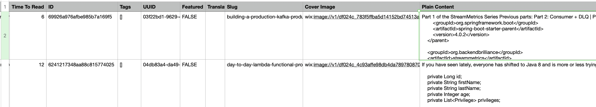
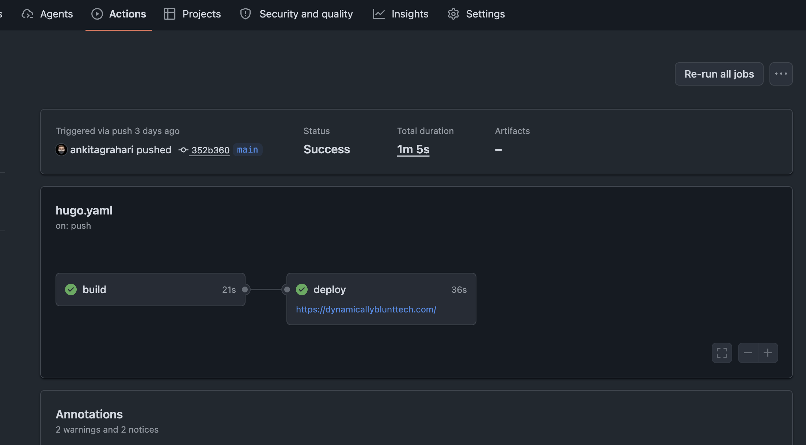

*My journey of migrating dynamicallyblunttech.com using Hugo, Markdown, Congo and GitHub Actions — including custom Python scripts, media extraction, a few surprises, and the things I am still figuring out.*

There is something interesting about being a backend developer.

You spend most of your working hours building systems, designing APIs, debugging production issues and figuring out why something that worked yesterday suddenly doesn't work today.

Then one day, you decide to build your **personal blog**.

And suddenly, you are dealing with things you never thought you would need to worry about: themes, typography, image formats, SEO, responsive layouts, content organization, DNS records and deployment pipelines.

Welcome to frontend engineering. Apparently, there is no escape!

My personal blog, [DynamicallyBluntTech](https://www.dynamicallyblunttech.com/), started on Wix. It was convenient, easy to manage and had everything I needed to publish technical articles.

But over time, I wanted more control.

I wanted my content in Markdown, my changes in Git, my website deployment automated and, most importantly, the freedom to experiment with AI-powered development workflows.

So I decided to migrate from Wix to:

- **Hugo** – Static site generator.
- **Markdown** – Content format.
- **Congo** – Hugo theme.
- **GitHub Pages** – Hosting.
- **GitHub Actions** – Automated deployment.
- **Python** – Custom migration and media extraction scripts.

This article covers what I actually did, what worked, what didn't, and what I still need to improve.

This is not a story about a perfect migration. It is about learning an unfamiliar publishing ecosystem while moving an existing website without losing its content.

## 1. Why I decided to leave Wix

Wix served me well when I started.

It provided a visual editor, CMS, media management, hosting and publishing capabilities without requiring me to understand the underlying infrastructure.

For someone who wants to focus on writing, that's a very reasonable deal.

However, my requirements started changing.

I wanted to:

- Own my content in a portable format.
- Version-control every article.
- Customize the website without depending on platform limitations.
- Automate publishing.
- Experiment with AI-assisted content workflows.
- Reduce the recurring cost of hosting a mostly static website.

The last point wasn't the only reason, but it certainly helped.

I also wanted to treat my blog like a software project rather than just another website managed through a dashboard.

That led me to Hugo and GitHub Pages.


## 2. What I gained and what I missed

Before getting into the migration, let's look at the trade-offs.

| Area | Wix | Hugo + GitHub Pages |
|---|---|---|
| Content management | Built-in CMS | Markdown files |
| Hosting | Managed platform | Static hosting |
| Version control | Limited developer workflow | Native Git history |
| Customization | Wix-dependent | Full control |
| Deployment | Wix publishing | GitHub Actions |
| Media management | Built-in Media Manager | Self-managed assets |
| SEO | Built-in tools | Configuration and additional work |
| AI integration | Platform-dependent | Direct repository access |
| Maintenance | Mostly managed | Developer-owned |

### What I gained

**Content ownership** : My articles are now individual Markdown files. I can edit them using any editor, keep them locally, push them to GitHub and even move to another static site generator in the future.

**Version control** : Every content change is tracked. I can compare versions, revert an accidental modification and review changes before publishing.
A blog post is now treated like source code. Which, considering how many code examples I publish, feels appropriate.

**Customization** : I can modify templates, add shortcodes, change styles and introduce new functionality without waiting for a platform feature.

**Automation** : A Git push triggers the build and deployment pipeline. Publishing is now part of my normal development workflow.

**AI compatibility** : My content, configuration and website structure are available as files. This opens up possibilities for AI-assisted writing, reviews, content transformation and automation.

### What I missed

There are things Wix does much better out of the box.

- Visual content editing.
- Built-in CMS management.
- Media management.
- Ready-made website components.
- Integrated forms and other dynamic functionality.
- A managed publishing experience.

With Hugo, I gained freedom but also inherited responsibility.

For example, I now need to think about how recommendations should appear, how articles should be grouped into series, how visitors should discover related content and how the homepage should represent the person behind the blog.

These things are not necessarily difficult, but they don't automatically happen just because the website builds successfully.

And that brings us to the migration itself.

## 3. Wix backup: CMS export was only the beginning

I didn't want to manually recreate every post and download every image.

Instead, I treated the migration as a data extraction exercise.

I used two approaches:

1. Wix CMS export to obtain structured content.
2. Wix APIs to retrieve additional information and media references.

This gave me a starting point for building a repeatable migration process.

### 3.1 What Wix already provides

Wix has a CMS and Media Manager that take care of much of the content storage and management.

The CMS contains structured collections and their associated fields. Depending on how the original website was implemented, blog content can also be stored through the Wix Blog application.

For my migration, I used the exported CMS dataset as the primary source for identifying the posts and their content.

The export provided structured information, but it wasn't a complete collection of ready-to-use Hugo assets.

I still needed to handle:

- Post titles and descriptions.
- Slugs and publication information.
- Categories and tags.
- Cover images.
- Images embedded inside articles.
- Video references.
- Static website pages.

This was an important distinction: **having the content data does not mean having all the media files required to rebuild the website.**

### 3.2 My custom Python migration scripts

This is where I started writing custom Python scripts.

The objective was simple: Take the CMS-exported dataset, identify image and video references, download the corresponding assets and organize everything into a Hugo-compatible directory structure.

The process looked like this:

```text
          Wix CMS Export
                 |
                 v
          Python Scripts
                 |
                 v
       Parse exported records
                 |
                 v
       Identify media references
                 |
          +------+------+
          |             |
          v             v
       Images         Videos
          |             |
          v             v
     Extract IDs    Extract URLs
          |             |
          v             v
       Wix Static Media API
                 |
                 v
         Download Assets
                 |
                 v
         Hugo Content Files
```

The images were properly mapped to each post, which made the final structure predictable and easier to maintain.

  Refer [here](https://github.com/ankitagrahari/dynamicallyblunttech/blob/main/utilities/wix_migrator.py) for the custom script I used for migration. 

### 3.3 Understanding Wix image URLs

When inspecting the exported content, I encountered image references in the following format:

```text
wix:image://v1/<media-id>/<filename>
```

For example:

```text
wix:image://v1/abc123_image-id~mv2.jpg/
architecture-diagram.png
```

This is a Wix-specific media reference, not a conventional image URL. The actual media can be accessed through Wix's static media infrastructure.

The general URL pattern is:

```text
https://static.wixstatic.com/media/<media-id>
```

My Python scripts extracted the relevant media ID and used the Wix static media URL to download the corresponding asset.

The basic logic was:

1. Read the image reference from the CMS record.
2. Extract the media identifier.
3. Construct the static media URL.
4. Download the asset.
5. Save it under the corresponding post directory.
6. Update the content references to use local paths.

One thing worth mentioning: Wix media references can contain transformation information, dimensions and additional parameters. The original asset identifier needs to be separated from these details rather than blindly using the entire reference as a URL.

I also validated the downloaded files because not every media reference necessarily resolves to a valid asset.

### 3.4 What about videos?

This was another interesting discovery.

The CMS dataset I worked with did not contain the videos I expected to find. Wix supports video media, but that doesn't mean every CMS export automatically includes every video used across the website.
Images and videos need to be considered separately when designing the extraction process.

For my migration, I included video URL identification in the custom scripts so that media references could be detected and handled. If videos are not present in the exported dataset, you need an additional source of information, such as the relevant media records or embedded content references.

Thankfully my videos were uploaded to my [yt channel](https://www.youtube.com/@ankitagrahari977), so extraction was not the burden I took, but it was not hunky dory as well, in some posts this hard labour was unavoidable. 

### 3.5 The AVIF surprise

I thought downloading the images would be the end of the story.

It wasn't.

Some of the downloaded assets were in AVIF format.

Hugo itself can work with several image formats, but the image-processing and theme workflow I was using did not handle my AVIF assets as expected. Rather than introduce more complexity into the content pipeline, I added another custom bash script to convert AVIF images into JPG.

The resulting workflow became:

```text
Download image
     |
     v
Identify image format
     |
     v
Is it AVIF?
     |
   Yes
     |
     v
Convert to JPG
     |
     v
Save under post directory
```

This was a small addition where once all the images are downloaded, you can run the script once and it will pick all avif formatted images and convert to jpg, making the migration more predictable. 
```bash
# Finds content folder, and then converts all avif images to jpg under images sub directory. 
find content -type f -path "*images*" | while read -r f; do
  if file -b "$f" | grep -q AVIF; then
    sips -s format jpeg "$f" --out "$f.tmp" && mv "$f.tmp" "$f" && echo "converted: $f"
  fi
done
```

It also reminded me that a successful download does not guarantee that an asset is immediately usable by the target platform.

## 4. Preparing the content structure for Hugo

Once the content and assets were extracted, I needed to organize them in a way Hugo could understand.
This was one of the most important parts of the migration. Hugo uses a content structure based on files and directories, and it supports page bundles. I decided to organize each blog post as its own directory.

For example:

```text
content/
└── posts/
    └── spring-boot-performance/
        ├── index.md
        ├── feature.jpg
        ├── architecture.png
        ├── metrics.png
        └── demo.mp4
```

This approach keeps the article and its related assets together.

### 4.1 Why feature.jpg?

One useful convention in my setup is using `feature.jpg` as the cover image.

Hugo and the Congo theme can use page resources and image configuration to display a featured image. By keeping the cover image consistently named, the migration script can automatically place it in the expected location. The Markdown file can then reference the image using the page bundle's resources.

For example:

```yaml
---
title: "Spring Boot Performance"
date: 2026-10-20
draft: false
description: "Understanding Spring Boot performance."
tags: ['Java', 'Spring Boot', 'Performance']
categories: ['Java', 'Spring Boot', 'Performance']
---
```

The directory contains the featured image and any other assets used by the article.

A typical page bundle therefore looks like:

```text
content/posts/spring-boot-performance/
    index.md
    feature.jpg
    images/
      architecture.png
```

### 4.2 Referencing images and videos inside posts

The other images and videos can be referenced directly from the post content using their page-relative paths or Hugo resource handling.

For example:

```markdown

```

A video can be referenced using "video" Hugo shortcode:

```markdown
{{ < video src="images/file.mp4" >}}
```

For larger videos, I would consider external video hosting rather than putting every video inside the Git repository. The idea is to keep the content portable without unnecessarily increasing repository size.

This structure also makes future AI-assisted content processing easier because all assets associated with an article are stored together.

## 5. Choosing Hugo and the Congo theme

With the content migration underway, I needed a static site generator and a theme.

I chose Hugo.

Hugo generates static websites from Markdown content and configuration files. It is fast, relatively simple to operate and doesn't require a database or application server to serve blog articles.

For a technical blog, it was a natural fit.

### 5.1 Why Congo?

I explored several Hugo themes before settling on Congo.

Some alternatives worth considering are:

| Theme | Characteristics |
|---|---|
| Congo | Modern, clean and feature-rich |
| PaperMod | Minimal and lightweight |
| Stack | Magazine-style content layout |
| Blowfish | Flexible personal website |
| Mainroad | Traditional blog experience |

I chose [Congo](https://jpanther.github.io/congo/) because it offered a good balance between customization and a clean reading experience.

I wanted the content to be the main attraction.

Technical articles already contain enough complexity. The website doesn't need to compete with them.

Congo provides useful features such as:

- Responsive design.
- Dark and light modes.
- Taxonomies and tags.
- Search support.
- Image handling.
- Customization options.
- Support for page bundles.

### 5.2 Installing Congo as a Git submodule

I used Congo as a Git submodule rather than copying the theme files directly into my repository.

This was an important decision.

The theme remains a separate Git repository, while my website repository references a specific version of it.

A simplified command looks like:

```bash
git submodule add \
  https://github.com/jpanther/congo.git \
  themes/congo
```

This gives me a clean separation between:

- My content.
- My website configuration.
- My customizations.
- The upstream theme.

It also means I can update the theme deliberately instead of having theme files mixed with my own changes.

One thing to remember is that Git submodules require recursive checkout in CI/CD. Otherwise, your local website might build successfully while GitHub Actions fails because the theme wasn't checked out.

A small detail, but one that can waste a surprising amount of debugging time.

## 6. Deploying through GitHub Pages and GitHub Actions

Once the site was working locally, I moved to deployment.

I wanted a simple publishing workflow where committing an article would automatically build and deploy the website.

The architecture is:

```text
Developer
   |
   v
Markdown / Hugo Configuration
   |
   v
Git Commit
   |
   v
GitHub Repository
   |
   v
GitHub Actions
   |
   v
Hugo Build
   |
   v
GitHub Pages
   |
   v
dynamicallyblunttech.com
```

### 6.1 Repository structure

My repository follows the general Hugo structure:

```text
dynamicallyblunttech/
│
├── .github/
│   └── workflows/
│       └── hugo.yaml
│
├── assets/
├── config/
├── content/
│   ├── posts/
│   ├── about/
│   └── other-pages/
│
├── layouts/
├── static/
├── themes/
│   └── congo/
│
├── hugo.toml
└── go.mod
```

The exact structure depends on the Hugo configuration and theme setup.

### 6.2 Custom domain migration

I already had a custom domain: dynamicallyblunttech.com.

I wanted to retain it rather than introduce a new domain and potentially disrupt existing readers.

The migration required configuring GitHub Pages with the existing custom domain and ensuring the DNS records pointed to GitHub Pages.

I also needed to make sure the Hugo `baseURL` matched the production domain.

For example:

```toml
baseURL = "https://www.dynamicallyblunttech.com/"
languageCode = "en"
title = "Dynamically Blunt Tech"
theme = "congo"
```

The DNS and HTTPS configuration are important because an incorrect domain or base URL can cause broken CSS, JavaScript and image references.

### 6.3 GitHub Actions deployment

I configured GitHub Actions to build and deploy the website whenever changes are pushed to the main branch.

The basic workflow is:

```yaml
name: Deploy Hugo Website

on:
  push:
    branches:
      - main
  workflow_dispatch:

permissions:
  contents: read
  pages: write
  id-token: write

jobs:
  build:
    runs-on: ubuntu-latest

    steps:
      - name: Checkout
        uses: actions/checkout@v4
        with:
          submodules: recursive

      - name: Install Hugo
        uses: peaceiris/actions-hugo@v3
        with:
          hugo-version: 'latest'
          extended: true

      - name: Build
        run: hugo --minify

      - name: Upload artifact
        uses: actions/upload-pages-artifact@v3
        with:
          path: ./public

  deploy:
    needs: build
    runs-on: ubuntu-latest

    environment:
      name: github-pages
      url: ${{ steps.deployment.outputs.page_url }}

    steps:
      - name: Deploy
        id: deployment
        uses: actions/deploy-pages@v4
```

This is an illustrative workflow. For a production setup, I recommend pinning the Hugo version and using tested action versions.

The final publishing process is now:

```bash
git add .
git commit -m "Add new technical article"
git push origin main
```

GitHub Actions takes care of the rest.

No manual deployment and no separate publishing interface.

## 7. The biggest benefit: GitHub Pages when AI enters the picture

This is probably the most interesting part of the migration.

A few years ago, I would have evaluated this decision primarily on hosting cost, performance and customization.

Today, AI changes the equation.

Consider the structure of my website now:

| Component | Format |
|---|---|
| Articles | Markdown |
| Configuration | TOML |
| Theme customizations | HTML, CSS, templates |
| Deployment | YAML |
| Images and videos | Static assets |
| Version history | Git |

Everything is accessible as files.

This makes the website much easier for AI tools and coding assistants to understand.

### 7.1 AI-assisted article writing

I can ask an AI coding assistant to inspect my existing articles and generate a new article using the same structure and metadata.

It can understand my writing style, identify related content and help maintain consistency.

### 7.2 Automated content review

I could introduce a GitHub Actions workflow that reviews Markdown files before deployment.

An AI agent could check:

- Missing images.
- Broken internal links.
- Missing SEO descriptions.
- Inconsistent headings.
- Outdated technical references.
- Incorrect code samples.

This is particularly useful for a technical blog where an article may remain online for years.

### 7.3 Repurposing technical content

A single article can become multiple pieces of content.

For example, an article on Kafka consumer performance could generate:

- A LinkedIn post.
- An Instagram carousel.
- A short reel script.
- Interview questions.
- A newsletter summary.

Instead of maintaining separate content sources, Markdown can remain the original source of truth.

### 7.4 Building a RAG-based technical assistant

This is an idea I particularly like.

My blog already contains articles on Java, Spring Boot, Kafka, microservices and AI. I could index these Markdown files, generate embeddings and store them in a vector database such as PGVector. Then I could build an assistant that answers technical questions using my own published content.

Essentially, the blog becomes a personal technical knowledge base.

### 7.5 The actual advantage

I wouldn't say GitHub Pages itself is the AI advantage.

1. The real advantage is having a website represented as structured, version-controlled source files.
2. Hugo generates the website.
3. Markdown stores the content.
4. Git manages changes.
5. GitHub Actions automates deployment.
6. AI can work across all these layers.

That combination gives me a lot more flexibility than a traditional visual CMS.

## 8. What I learned: A working website is not necessarily a finished website

I was completely new to this style of blog development. I had experience building backend applications, APIs and distributed systems, but building a complete publishing experience was a different challenge.

Initially, I was focused on getting the migration right:

- Extract the content.
- Download the images.
- Organize the Markdown files.
- Configure Hugo.
- Install the theme.
- Deploy through GitHub Actions.
- Retain the existing domain.

Once all of that worked, I thought the major work was finished.

Then I looked at the homepage.

It was essentially a list of blog posts. The articles were there, the website was accessible and deployment was working. 

But something was missing.

A personal technical blog should do more than display a chronological list of articles. It should help readers discover content, understand the author's interests and navigate related topics. And that's where I realized I had migrated the content successfully but hadn't finished designing the publishing experience.

## 9. What's still left to improve on dynamicallyblunttech.com?

There are several improvements on my roadmap.

### 9.1 Content grouping and learning paths

This is currently one of my biggest concerns.

For example, imagine I publish four articles on Spring AI. A reader should be able to discover all four as a related series.

Instead, the current website primarily displays individual posts. Articles belonging to the same topic can appear on different pages, which makes the reading journey less intuitive.

I need a more strategic content organization approach.

Possible improvements:

- Topic-based landing pages.
- Series pages.
- Ordered article navigation.
- Previous and next article links within a series.
- Related article recommendations.

For example:

```text
Spring AI Learning Path
        |
        +-- 1. Introduction to Spring AI
        |
        +-- 2. Understanding Embeddings
        |
        +-- 3. Building RAG Applications
        |
        +-- 4. Implementing AI Agents
```

This is more useful than expecting readers to discover related articles by scrolling through the entire blog.

### 9.2 Homepage redesign

The current homepage is functional, but it still needs a proper identity.

I want to move beyond a simple list of articles.

Some elements I would like to introduce:

- A short introduction about the author.
- Featured technical articles.
- Topic-based content sections.
- Latest articles.
- Popular articles.
- Learning series.
- Recommendations for new readers.

The homepage should answer three questions quickly:

1. Who is behind this blog?
2. What kind of technical content can I find here?
3. Where should I start reading?

### 9.3 SEO and URL redirects

Moving from Wix to Hugo should not mean losing the URL history of existing articles.

I still need to complete a systematic review of:

- Old Wix URLs and their new Hugo equivalents.
- Redirect rules.
- Canonical URLs.
- Sitemap.
- Robots.txt.
- Structured data.
- Open Graph metadata.
- Search engine indexing.

Preserving old URLs and implementing appropriate redirects is especially important for existing readers and search traffic.

### 9.4 Analytics

I also need a better understanding of how people use the website.

Some metrics worth tracking:

- Most-read articles.
- Popular categories.
- Traffic sources.
- Search terms.
- Reader engagement.

This would help me decide what to write next.

### 9.5 Image optimization

The migration handled image downloads and format conversion, but image optimization is a separate task. I still want to improve:

- Image dimensions.
- Responsive image delivery.
- File sizes.
- Modern image formats where supported.
- Lazy loading.
- Alt text.

A static website can still become unnecessarily heavy if every article loads large original images.

## 10. Final thoughts

Moving from Wix to Hugo wasn't just a change in hosting. It changed how I think about managing my personal website. I moved from a managed CMS to a developer-owned publishing workflow built around Markdown, Git and automation. I gained control over my content, learned how to extract and organize media programmatically, built custom Python scripts and introduced automated deployment. I also discovered that building a website is not just about making it work. The content structure, navigation, homepage, reader experience and discoverability matter just as much.

Would I recommend Hugo and GitHub Pages to everyone?

Probably not.

If you simply want to write and publish without worrying about infrastructure, Wix or another managed platform may be a better fit.

But if you're a developer who enjoys building things, experimenting with automation and having control over your content, this approach is worth exploring.

And with AI becoming part of everyday development, having your content and website represented as structured source files opens up some interesting possibilities.

My blog is still a work in progress. The migration is done, but the publishing experience is evolving.

**The goal isn't just to have a website that publishes articles. It's to build a technical knowledge platform that grows alongside what I learn and build.**

And yes, I now have one more repository to maintain. Apparently, developers never really escape maintenance.

---

**Website:** [Dynamically Blunt Tech](https://www.dynamicallyblunttech.com/)  
**Author:** Ankit Agrahari  

---