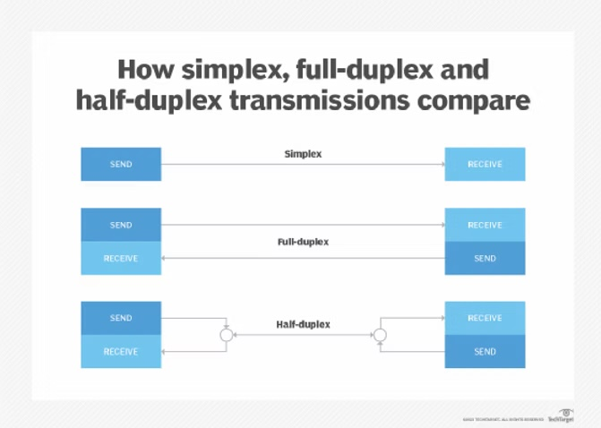

In this post we will be creating a Web Socket Client which will receive all messages coming from the Web Socket Server.

### **Web Sockets**

The web socket is a communication protocol like HTTP used in client - server architecture. But, unlike HTTP, web-sockets are ***bi-directional, full duplex*** communication protocol. This means that the data can be flown in either directions, client to server or server to client. 

Web Sockets starts with either ***ws://*** or ***wss://***

It is ***state-ful*** protocol, which means the communication between client and server is kept alive for the entire duration until it is closed by either client or server.



### **Web Socket Server**

I received a task to capture stream of messages send from Server and we have to read each message and do some post validations on those messages and may be store the data in database or in-memory. This post will be about receiving the messages from server and printing it on the console by the client.

I have the server which is running on the port 8032. This is some jar file which cannot be changed. It send data in JSON format which describes the product id (isin), a little description about it and the event type(type) whether to add it to our list or delete it. It looks something like this

```java
{
  "data": {
    "description": "impetus tellus appareat movet",
    "isin": "OV5407757082"
  },
  "type": "ADD"
}
```

### **Web Socket Client**

We will be using **javax.websocket** package for creating the client. Also, we will annotate the client class with ***@****ClientEndpoint* which will denotes that this class is my Web Socket client and will have the web socket lifecycle events.

In order to create a Web Socket client, we need to create a Web Socket container which will provide helpful methods to connect to the server. To connect to the server, like any rest API, here also we will have URLs which will be called by the client class.

To create the container, we have *ContainerProvider *abstract*** ***class provided by the javax.websocket package. It has *getWebSocketContainer()* method which creates a *WebSocketContainer *instance using the ***org.apache.tomcat.websocket.WsWebSocketContainer*** class. 

Refer to the code for *ContainerProvider.getWebSocketContainer() *method from the abstract class from Java 8.

```java
public static WebSocketContainer getWebSocketContainer() {

    WebSocketContainer result = null;
    ServiceLoader<ContainerProvider> serviceLoader = ServiceLoader.load(
            ContainerProvider.class);

    for(
        Iterator iter = serviceLoader.iterator(); 
        result == null && iter.hasNext(); 
        result = ((ContainerProvider)iter.next()).getContainer()
    ) {}

    if (result == null) {
        try {
            Class<WebSocketContainer> clazz = Class.forName(
                "org.apache.tomcat.websocket.WsWebSocketContainer");
            result = (WebSocketContainer)clazz
                .getConstructor()
                .newInstance();
                
        } catch (IllegalArgumentException 
            | SecurityException 
            | ReflectiveOperationException var4) {
        }
    }
    return result;
}
```

Once you have the container instance, we can call the *connectToServer()* method with two arguments, one is the instance *this* and other is the server URL exposed. 

You need to handle the *DeploymentException *and *IOException *here.

```java
public MyWebSocketClientEndpoint(URI uri){
    WebSocketContainer container = ContainerProvider
                    .getWebSocketContainer();
    try {
        container.connectToServer(this, uri);
    } catch (DeploymentException e) {
        e.printStackTrace();
    } catch (IOException e) {
        e.printStackTrace();
    }
}
```

### **Lifecycle Methods**

Now as part of the client, there are three phases for every connection
* ***onOpen*** - what needs to be done, when we open the connection
* ***onClose*** - what needs to be done, when we close the connection
* ***onMessage*** - what needs to be done, when we receive the messages from the server during the session.

So, as part of the every Web Socket Client lifecycle methods, we will implement these three phases. 

***NOTE***: You might have noticed, that I have written phases and not methods, because we can provide any method name here. To recognize the phase we need to annotate the respective methods with ***@****onOpen*, or ***@****onClose*, or ***@****onMessage* annotation.

You can have any implementation in these methods, but I will just print the name and messages on the console as part of this post.

```java
@OnOpen
//Method Name can be anything
public void onOpen(Session session){
    System.out.println("On Open");
    this.session = session;
}

@OnClose
//Method Name can be anything
public void onClose(){
    System.out.println("On Close");
    this.session = null;
}

@OnMessage
//Method Name can be anything
public void onMessage(String message){
    System.out.println("On Message:"+ message);
}
```

To test this, we can call out *MyWebSocketClientEndpoint *class and provide the correct URL, which will start the connection to the server. If you want to keep on receiving the messages from the server and keep the connection open, use *Thread.sleep()* to keep the connection alive. Else it will close the socket connection with the server after few messages only. Providing the thread to sleep, allows the message stream to be printed on the console.

You can refer to my github projects [*here*](https://github.com/ankitagrahari?tab=repositories) and refer to this class [*MyWebSocketClientEndpoint.java*](https://github.com/ankitagrahari/trStocks/blob/main/src/main/java/com/tr/trstocks/websocket/client/MyWebSocketClientEndpoint.java) for the entire code.

Hope this helps others also. Please do suggest more content topics of your choice and share your feedback. Also [*subscribe and appreciate*](https://razorpay.com/payment-button/pl_IKvqCobZrv20Av/view/?utm_source=payment_button&utm_medium=button&utm_campaign=payment_button) the blog if you like it.